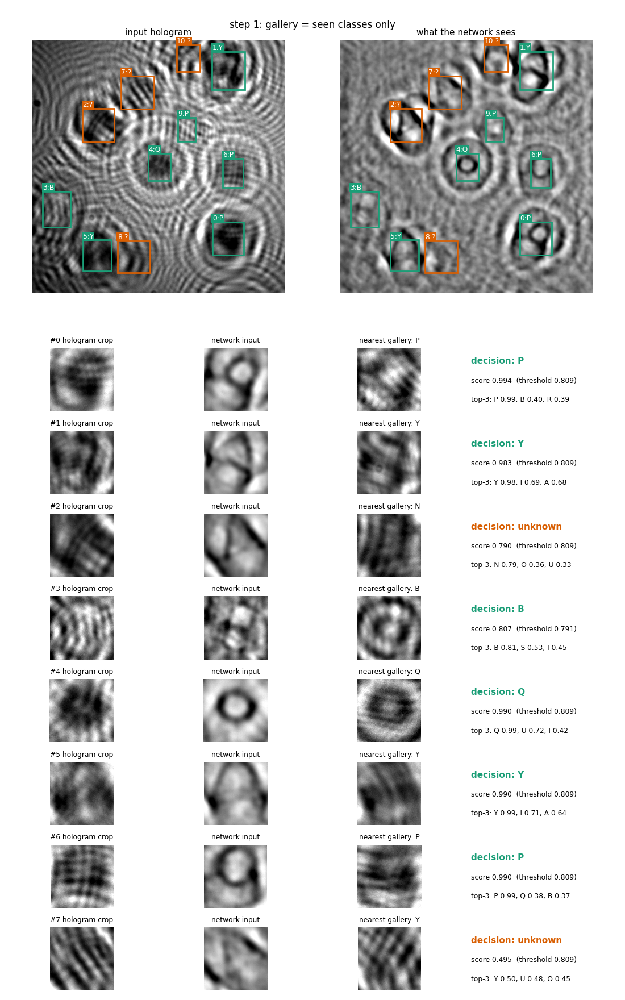
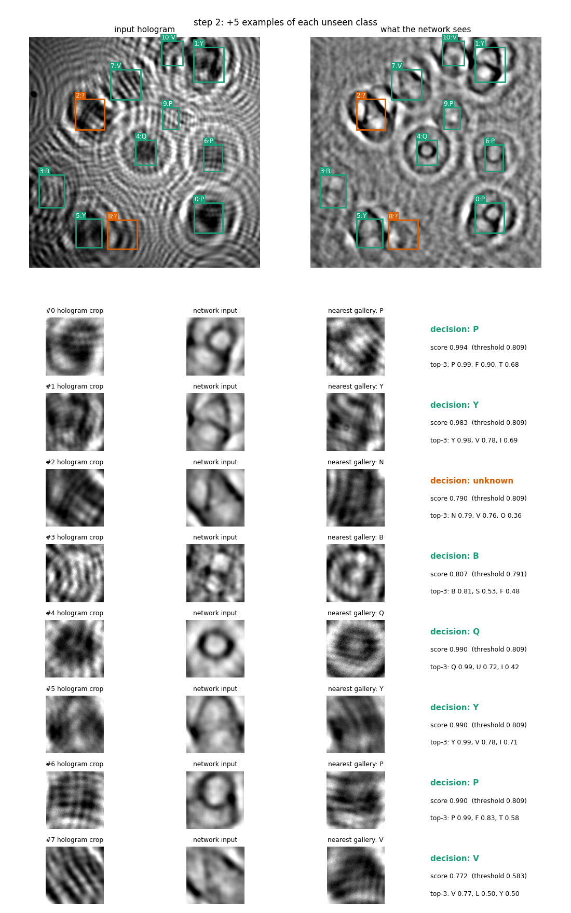

# holo-openset

Open-set recognition of interference patterns on raw lensless holograms with a learnable Fourier layer.

This repository holds everything behind the paper, as one pipeline: the simulated acquisition, the conventional
reconstructions, the training of every model, the evaluation, and the figures and tables.

```text
simulate the bench -> reconstruct (conventional flows) -> train one network per flow -> evaluate
     sim/                  reconstruct.py                      train.py               evaluate.py
                    -> experiments (end to end, robustness, full sensor, timing) -> figures and tables
                              experiments/                                              paper/
```

To check the results of the paper, go to **[docs/REPRODUCIBILITY.md](docs/REPRODUCIBILITY.md)**.

## What the system does

An in-line hologram does not show its objects: each object becomes interference rings that spread far beyond it and
mix with those of its neighbours. The system recognises these patterns **on the hologram itself**, with no numerical
reconstruction and no optical parameter (wavelength, distance, pixel pitch), and in an **open set**:

```text
hologram (any size: a 640 x 640 window or the whole sensor, 3840 x 2748)
  |  YOLO localiser (one class, "pattern"; trained on seen classes only; in tiles on a full frame)
  |  learnable Fourier layer on the whole image: FFT -> one weight per frequency radius -> inverse FFT
  |  crop of each pattern -> ResNet18 -> 128-dimensional embedding
  |  comparison with the GALLERY (cosine similarity to labelled examples)
  |- score >= threshold of the nearest class -> that class
  '- score <  threshold                      -> "unknown"
        '- unknown patterns are grouped into candidate new classes (discovery)
```

A new class is recognised by **enrolling examples of it in the gallery**, with no retraining.

The conventional flows compared in the paper use the same network and change only what it receives (`flows.py`):

| flow | input of the network |
|---|---|
| `raw` | the hologram |
| `learned` | real learned layer (gain only; ablation) |
| `complex` | complex learned layer |
| `wiener` | fixed filter at the nominal distance |
| `prop` | the layer with the phase of the propagation: one scalar, calibrated on the holograms (the proposed method) |
| `bank_jit` | the same at 5 distances over $\pm$5 %, trained with distance jitter (the variant robust to a drifting distance); `bank_w1`, `bank_w3`, `bank_wide` are wider stacks of the ablation |
| `rec_z0` | back-propagation at the nominal distance |
| `rec_af` | blind autofocus, 114 reconstructions |
| `rec_edf` | focus per object |
| `rec_twin` | autofocus and twin-image removal |

## Demonstration

`python -m holo_openset demo --rep 2` (never-seen classes: E F L T V). Step 1, gallery with the seen classes only: the
V, never seen, come out as `?`. Step 2, after enrolling 5 examples of each new class, without retraining:




## Installation

Python 3.11 and an NVIDIA GPU with CUDA 12. The commands below run from the root of the repository.

```bash
conda env create -n holo-openset -f environment.yml
conda activate holo-openset
pip install -r requirements-lock.txt
pytest                                    # about 20 s, CPU, no data needed
```

Every command uses **one** device, `--device cpu` or `--device cuda:N`.

## Use

These commands need the trained models and the data ([docs/DATA.md](docs/DATA.md)).

```bash
# two-step demonstration: new classes are rejected, then recognised once enrolled
python -m holo_openset demo --rep 2 --flow learned --device cuda:0 --out-dir demo_out

# gallery and prediction on 8-bit PNG holograms of any size
python -m holo_openset enroll  --rep 2 --classes seen --out gallery.npz --device cuda:0
python -m holo_openset predict --rep 2 --gallery gallery.npz --device cuda:0 hologram.png
python -m holo_openset discover --rep 2 --gallery gallery.npz --device cuda:0 holograms/*.png
```

`--flow rec_z0`, or any other flow, runs the same system with a conventional reconstruction in front of it.

## Structure

```text
holo_openset/
  sim/            simulator: optics and camera (physics.py), scenes, letters and fonts, robustness variants
  reconstruct.py  flat field, back-propagation, autofocus, per-object focus, twin-image removal
  model.py        Fourier layer (real or complex, any image size) and ResNet18
  flows.py        the compared flows        train.py, evaluate.py   training and the strict protocol
  gallery.py      gallery and thresholds    detect.py, yolo.py      localiser, in tiles on a full frame
  predict.py      use on files              cli.py                  command line
  experiments/    end to end, robustness, oracle, discovery, full frames, timing, fidelity, gaps
  paper/          figures and tables        pipeline.py             queue of jobs, one GPU per job
  reproduce.py    the three levels of reproduction
results/          csv and json behind every table and figure
expected/         the tables and numbers of the paper, for comparison
checksums/        SHA-256 of the Zenodo archives and of every simulated set
docs/             REPRODUCIBILITY.md, DATA.md, EQUIPMENT.md
```

## Citation and license

Please cite this software through [CITATION.cff](CITATION.cff). The code is under the
[GNU Affero General Public License v3.0](LICENSE). The fonts in `holo_openset/sim/fonts` keep their own licences,
listed in the README of that folder.
