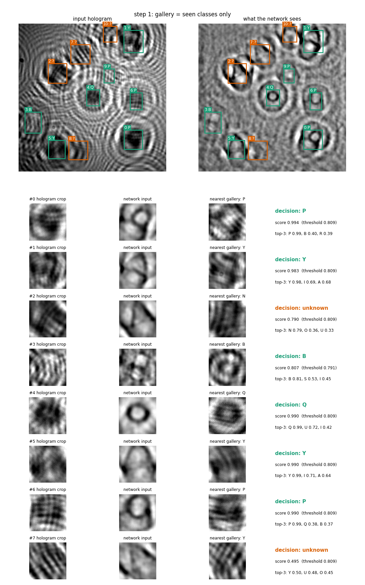
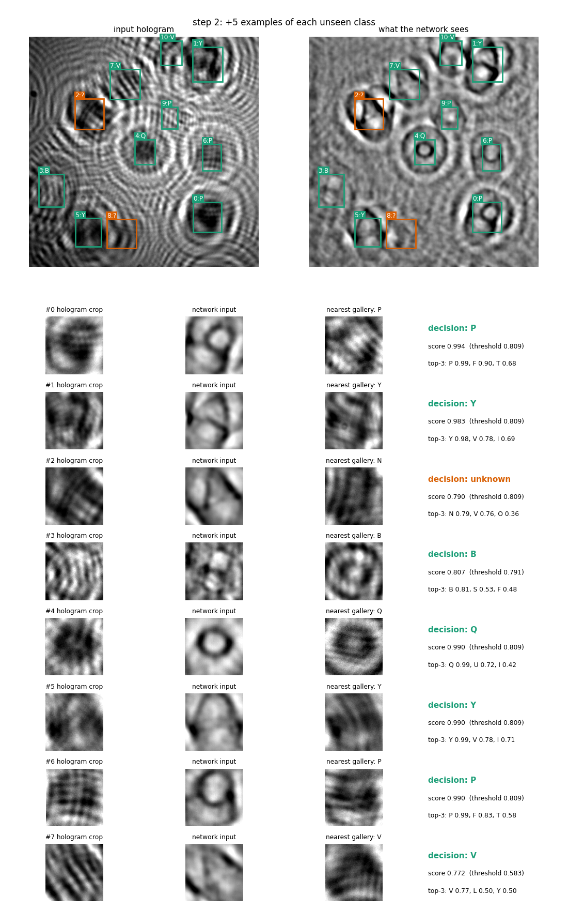

# holo-openset

Open-set recognition of interference patterns on lensless holograms: why crops of the raw hologram fail, and what a
propagation step costs from a window to the whole field of view.

This repository holds everything behind the paper, as one pipeline: the simulated acquisition, the conventional
reconstructions, the training of every model, the evaluation, and the figures and tables.

```text
simulate the bench -> reconstruct (conventional flows) -> train one network per flow -> evaluate
     sim/                  reconstruct.py                      train.py               evaluate.py
                    -> experiments (end to end, robustness, full sensor, timing) -> figures and tables
                              experiments/                                              paper/
```

To check the results of the paper, go to **[docs/REPRODUCIBILITY.md](docs/REPRODUCIBILITY.md)**.

## What the system does

An in-line hologram does not show its objects: each object becomes interference rings that spread far beyond it and
mix with those of its neighbours. The system recognises these patterns in an **open set**. The paper measures that a
network applied to crops of the raw hologram recognises the seen classes in a sparse sample but accepts most patterns
of classes it never saw, because the fringes of the neighbours enter each crop; a **propagation step before the crop**
removes this. The system therefore propagates the whole image first, either with the **propagation layer** (`prop`),
which calibrates its own distance on unlabelled holograms and needs no optical parameter, or with a back-propagation at
the calibrated distance (`rec_z0`), the better route on dense samples and when the distance of the sample changes:

```text
hologram (any size: a 640 x 640 window or the whole sensor, 3840 x 2748)
  |  YOLO localiser (one class, "pattern"; trained on seen classes only; in tiles on a full frame)
  |  propagation step on the whole image: FFT -> phase of the free-space propagation (one scalar) -> inverse FFT
  |  crop of each pattern -> ResNet18 -> 128-dimensional embedding
  |  comparison with the GALLERY (cosine similarity to labelled examples)
  |- score >= threshold of the nearest class -> that class
  '- score <  threshold                      -> "unknown"
        '- unknown patterns are grouped into candidate new classes (discovery)
```

A new class is recognised by **enrolling examples of it in the gallery**, with no retraining.

The conventional flows compared in the paper use the same network and change only what it receives (`flows.py`):

| flow | input of the network |
|---|---|
| `raw` | the hologram (crops of the raw hologram: the route that fails in the open set) |
| `learned` | real learned layer (gain only; ablation) |
| `complex` | complex learned layer |
| `wiener` | fixed filter at the nominal distance |
| `prop` | the layer with the phase of the propagation: one scalar, calibrated on the holograms (the proposed method) |
| `bank_jit` | the same at 5 distances over $\pm$5 %, trained with distance jitter (the variant robust to a drifting distance); `bank_w1`, `bank_w3`, `bank_wide` are wider stacks of the ablation |
| `rec_z0` | back-propagation at the nominal distance |
| `rec_af` | blind autofocus: 73 + 41 candidate distances over 0.2-2.1 times the nominal one, 114 reconstructions |
| `rec_afc` | narrow autofocus: 7 + 11 candidates within $\pm$10 % of the nominal distance (so it needs it within $\pm$13 %), on the amplitude averaged 4 x 4 (18 reconstructions of 1/16 of the pixels); no model of its own, it uses that of `rec_af` |
| `rec_edf` | focus per object |
| `rec_twin` | blind autofocus and twin-image removal |

The narrow autofocus comes from a pre-registered study of the distance and the autofocus (`docs/exp_distancia/`, in
Portuguese): its results are kept in `results_exp_distancia/`, and `python -m holo_openset paper distance` turns them
into the second file of numbers of the paper, `numbers_distancia.tex`.

The section of the paper on the simulation (the bench at its own distance of about 1 mm, the density curve, the depth
of the sample, a change of the distance and the focal stacks) comes from a second pre-registered study
(`docs/exp_resolucao/`, in Portuguese: protocols, dated notebooks of every registration and reading, plan file). Its
scripts are in `scripts/exp_resolucao/`, its results in `results_exp_resolucao/`, and
`python scripts/exp_resolucao/paper_resolucao.py --out <paper>/figures/paper` turns them into the third file of numbers
of the paper, `numbers_resolucao.tex`, with its tables.

## Demonstration

`python -m holo_openset demo --rep 2` (never-seen classes: E F L T V). Step 1, gallery with the seen classes only: the
V, never seen, come out as `?`. Step 2, after enrolling 5 examples of each new class, without retraining:




## Installation

Python 3.11 and an NVIDIA GPU with CUDA 12. The commands below run from the root of the repository.

```bash
conda env create -n holo-openset -f environment.yml
conda activate holo-openset
pip install -r requirements-lock.txt
pytest                                    # about 20 s, CPU, no data needed
```

Every command uses **one** device, `--device cpu` or `--device cuda:N`.

## Use

These commands need the trained models and the data ([docs/DATA.md](docs/DATA.md)).

```bash
# two-step demonstration: new classes are rejected, then recognised once enrolled
python -m holo_openset demo --rep 2 --flow learned --device cuda:0 --out-dir demo_out

# gallery and prediction on 8-bit PNG holograms of any size
python -m holo_openset enroll  --rep 2 --classes seen --out gallery.npz --device cuda:0
python -m holo_openset predict --rep 2 --gallery gallery.npz --device cuda:0 hologram.png
python -m holo_openset discover --rep 2 --gallery gallery.npz --device cuda:0 holograms/*.png
```

`--flow rec_z0`, or any other flow, runs the same system with a conventional reconstruction in front of it.

## Structure

```text
holo_openset/
  sim/            simulator: optics and camera (physics.py), scenes, letters and fonts, robustness variants
  reconstruct.py  flat field, back-propagation, autofocus, per-object focus, twin-image removal
  model.py        Fourier layer (real or complex, any image size) and ResNet18
  flows.py        the compared flows        train.py, evaluate.py   training and the strict protocol
  gallery.py      gallery and thresholds    detect.py, yolo.py      localiser, in tiles on a full frame
  predict.py      use on files              cli.py                  command line
  experiments/    end to end, robustness, oracle, discovery, full frames, timing, fidelity, gaps
  paper/          figures and tables        pipeline.py             queue of jobs, one GPU per job
  reproduce.py    the three levels of reproduction
results/          csv and json behind every table and figure
results_exp_distancia/  the results of the distance study (numbers_distancia.tex), docs/exp_distancia/
results_exp_resolucao/  the results of the simulation study (numbers_resolucao.tex), docs/exp_resolucao/
scripts/          the runs and the generators of the two studies (exp_distancia/, exp_resolucao/)
expected/         the tables and the two files of numbers of the paper, for comparison
checksums/        SHA-256 of the Zenodo archives and of every simulated set
docs/             REPRODUCIBILITY.md, DATA.md, EQUIPMENT.md; the records of the two studies
```

## Citation and license

Please cite this software through [CITATION.cff](CITATION.cff). The code is under the
[GNU Affero General Public License v3.0](LICENSE). The fonts in `holo_openset/sim/fonts` keep their own licences,
listed in the README of that folder.
