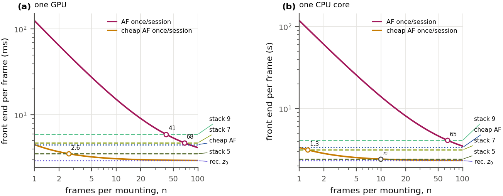
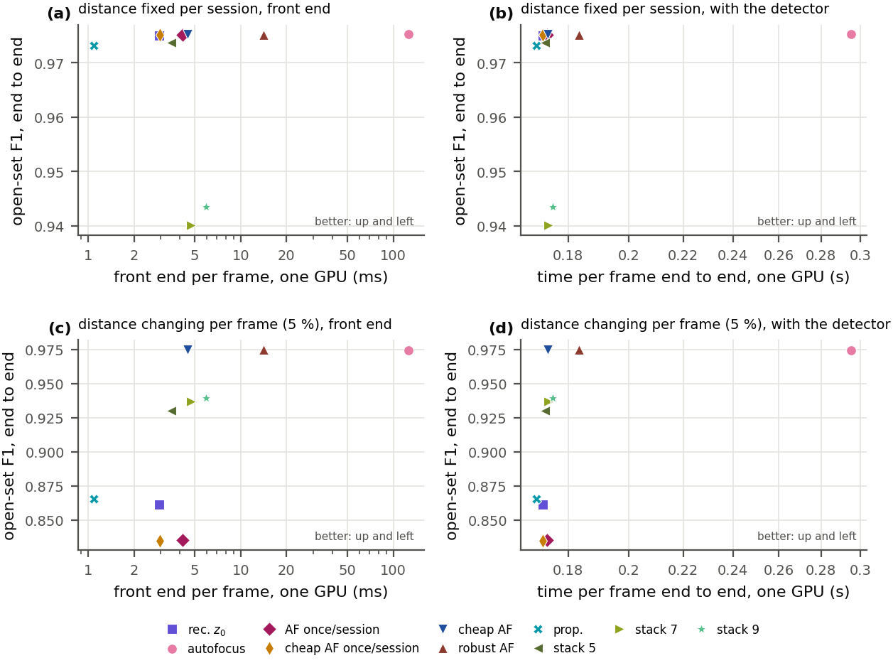
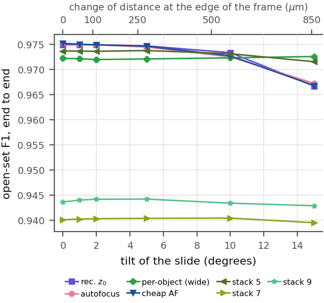

# Relatório: quando o focal stack economiza tempo de verdade

Protocolo: `docs/exp_distancia/PROTOCOLO.md`. Caderno: `docs/exp_distancia/CADERNO.md`. Branch `exp/distancia-autofocus`.

## 0. Resumo e origem dos números

1. Com z fixo por sessão, buscar z uma vez por sessão dá o F1 da busca em todo quadro. Com a busca barata, isso custa o mesmo que reconstruir em z₀, menos que o stack.
2. O ganho de dezenas de vezes do stack só existe contra a busca cega em todo quadro. Contra a busca barata em todo quadro (`afc`), o front end do stack de 5 é 1,3× (GPU) e 1,4× (CPU) mais barato; fim a fim, 1 % e 4 %.
3. A busca `afc` custa 78× menos que a cega em GPU e 111× menos em CPU, tem o mesmo F1 nos conjuntos limpos e não quebra sob ruído forte nem sob feixe estreito.
4. O critério pré-registrado de "ganho de tempo legítimo" vale em 1 de 24 linhas (leitura A) ou 2 de 24 (leitura B). A linha comum é o stack de 5 sob drift lento.
5. A inclinação não muda nenhum fluxo até 5°. A 15° o stack fica +0,005 acima da busca barata, em 4 de 5 repetições.

**Origem.** Tabelas copiadas de `results_exp_distancia/distance/tables/*.md` sem alterar valores (ponto decimal; algumas colunas cortadas; sem desvio padrão nas Tabelas 1 e 6); macros em `results_exp_distancia/numbers_distancia.tex`; o resto, do caderno. Comando: `bash scripts/exp_distancia/relatorio.sh` (roda `HOLO_PAPER=$PWD/results_exp_distancia python -m holo_openset paper distance` e copia macros e figuras). Sessão de tempo `results_exp_distancia/e5/`: GPU da tentativa 2 (`e5_a2`, 23:28–23:34, `timing` e `full_frames` no mesmo run, escolha do responsável) e um core de CPU (22:18–22:25).

## 1. Respostas

- **Q1** (z fixo por sessão): não; a busca uma vez por sessão tem o F1 da busca em todo quadro e, feita com a busca barata, custa o mesmo que `rec_z0`, menos que o stack.
- **Q2** (z por quadro): o ganho de tempo existe contra a busca cega, mas contra a busca barata em todo quadro cai para no máximo 1,3× (GPU) e 1,4× (CPU) no front end, e o critério pré-registrado só vale para o stack de 5 no drift lento (e em `frame_2` na leitura B).
- **Q3** (busca mais barata e robusta): sim; uma busca de ±10 % sobre a amplitude reduzida 4× custa 1/78 da cega em GPU, não perde F1 e recupera os conjuntos com ruído forte e feixe estreito.
- **Q4** (inclinação): não na faixa plausível; nada muda até 5°, e a 15° a diferença a favor do stack é +0,005, pequena e em 4 de 5 repetições.

### Q1: evidência

Em `base`, `session_2` e `session_5`, `rec_afs` (busca cega no primeiro quadro da sessão) e `rec_af` (busca cega em todo quadro) diferem em 0,000 na média pareada, com no máximo 0,002 numa repetição (`tab_dist_paired`). H1 se confirma. Com n = 100, `rec_afs` custa 4,2 ms por quadro em GPU e 3,5 s em CPU, contra 2,9 ms e 2,3 s de `rec_z0` (Tabela 3). A busca barata por sessão (`rec_afsc`) custa 2,94 ms e 2,32 s, praticamente `rec_z0`. O stack de 5 (3,5 ms; 2,4 s) custa mais que isso, embora menos que `rec_afs` (a busca cega só fica mais barata que ele a partir de n\* = 205 em GPU), e perde 0,125 de F1 em `session_5` contra `rec_afc`. Os stacks largos perdem de 0,011 a 0,020 contra `rec_afc` nos seis conjuntos sem ruído forte nem feixe estreito.

O E1 pedia a variância entre sessões (`tab_dist_sessions`). A busca cega por sessão erra por mais de 192 µm (1 % de z₀) em 4 das 8 sessões de `fullwell_500` e em 7 das 8 de `beam_narrow`. Nessas sessões a acurácia nas classes vistas de `rec_afs` vai a 0,000 e 0,042 (duas sessões de `fullwell_500`; nas outras duas, 0,898 e 0,918) e a 0,000 nas sete de `beam_narrow`. A busca barata por sessão não erra em nenhuma sessão desses conjuntos; a acurácia dela fica em 0,916–0,937 e 0,924–0,957. Em `session_5` nenhuma das duas erra.

**Tabela 1.** Open-set F1 nas janelas de teste, média de r1–r5. Negrito: mais de 0,05 abaixo do mesmo fluxo no base.

| fluxo | base | session_2 | session_5 | frame_2 | frame_5 | walk_05 | fullwell_500 | beam_narrow |
|---|---|---|---|---|---|---|---|---|
| rec_z0 | 0.964 | 0.939 | **0.753** | 0.955 | **0.865** | 0.934 | 0.950 | 0.959 |
| rec_af | 0.964 | 0.964 | 0.964 | 0.964 | 0.964 | 0.964 | **0.770** | **0.432** |
| rec_afs | 0.964 | 0.964 | 0.964 | 0.927 | **0.727** | 0.927 | **0.803** | **0.220** |
| rec_afsc | 0.964 | 0.964 | 0.964 | 0.927 | **0.725** | 0.926 | 0.949 | 0.959 |
| rec_afM | 0.964 | 0.964 | 0.964 | 0.946 | **0.798** | 0.963 | **0.734** | **0.404** |
| rec_afc | 0.964 | 0.964 | 0.964 | 0.965 | 0.964 | 0.965 | 0.949 | 0.959 |
| rec_afr | 0.964 | 0.964 | 0.964 | 0.965 | 0.964 | 0.965 | 0.950 | 0.959 |
| prop | 0.963 | 0.939 | **0.749** | 0.954 | **0.865** | 0.930 | 0.956 | **0.879** |
| bank_jit | 0.963 | 0.957 | **0.839** | 0.961 | 0.924 | 0.953 | 0.963 | **0.878** |
| bank_wide | 0.952 | 0.952 | 0.944 | 0.952 | 0.949 | 0.951 | 0.952 | **0.871** |
| bank_w2 | 0.952 | 0.953 | 0.944 | 0.953 | 0.948 | 0.952 | 0.952 | **0.875** |

### Q2: evidência

Com z por quadro, as políticas por sessão caem mais do que H2 esperava. Em `frame_5`, `rec_afs` e `rec_afsc` ficam em 0,727 e 0,725, abaixo de `rec_z0` (0,865), e não em 0,75. Em `frame_2` e `walk_05` ficam em 0,926–0,927. `rec_afM` (busca cega a cada 10 quadros) só serve no drift lento: 0,963 em `walk_05`, 0,946 em `frame_2`, 0,798 em `frame_5`. `rec_af`, `rec_afc` e `rec_afr` ficam em 0,964–0,965. Os stacks largos ficam a 0,015–0,016 de `rec_af` em `frame_5`, como H2 previa; o de 5 fica 0,040 abaixo de `rec_afc`.

Tempo (Tabela 3). Contra `rec_af`, o front end do stack de 5 é 35,71× mais barato em GPU e 49,10× em CPU; fim a fim, 1,71× e 5,75×. Contra `rec_afc` sobra 1,28× e 1,39×: 4,50 contra 3,52 ms (cerca de 1 ms) e 3,36 contra 2,42 s (cerca de 0,9 s) por quadro. Fim a fim, 1,01× e 1,04×. Os stacks largos, os únicos que seguram o F1 a 5 %, custam 4,72 e 5,93 ms em GPU, mais que `rec_afc`. Em CPU o de 7 (3,14 s) é mais barato que `rec_afc` (3,36 s); o de 9 (4,10 s) não.

Critério (Tabela 4). A frase "mais barato que o mais barato dos fluxos convencionais que atingem esse F1" admite duas leituras. **A**: contam os convencionais com F1 a até 0,02 do melhor, a tolerância dada ao stack. **B**: contam os que atingem o F1 do próprio stack. O stack de 5 cumpre em `walk_05` nas duas (−0,0122, 5/5; 3,52 contra 4,50 ms e 2,42 contra 3,36 s, contra `rec_afc`). Em `frame_2` cumpre só na B; na A, `rec_z0` (0,955) qualifica e custa 2,93 ms. O de 7 tem F1 suficiente em `frame_5` e `walk_05`, mas só é mais barato em CPU. O de 9 nunca cumpre. Em `session_5` os largos falham o 0,02 por 0,0004 (−0,0204). Em `fullwell_500` os três ficam acima do melhor convencional (o de 5 com +0,0127, 5/5) e custam mais que `rec_z0`; na B nenhum convencional chega ao F1 deles ("none reaches it"), e a leitura não diz se isso cumpre o critério. Em `beam_narrow` falham o F1 por 0,08. **A escolha entre A e B é do orientador.** Ressalvas: o melhor convencional às vezes ganha por menos de 0,0002 (`rec_afc` 0,96475 contra `rec_afr` 0,96473 em `walk_05`), o que muda a referência da diferença mas não os vereditos; e o critério usa o F1 das janelas, enquanto nos quadros inteiros os stacks largos ficam 0,032–0,038 abaixo de `rec_afc` (Tabela 7).

n\* (Tabela 5, Figura 1) é o número de quadros por montagem a partir do qual buscar uma vez por montagem fica mais barato que o stack. Para o stack de 5, com a busca barata: 2,6 (GPU) e 9,9 (CPU) na conta completa, que cobra do convencional flat field, back-propagation e canais (regra 8.4); 0,6 e 0,7 na simplificada (fórmula da Seção 3 do protocolo). Com a busca cega: 205 e 1099; 48 e 83. A Seção 2 explica a diferença.

**Tabela 2.** Erro de distância no teste: mediana (µm) / falha grosseira (% com erro > 192,5 µm). Entre parênteses, reconstruções por imagem (amortizadas em `afs`, `afsc`, `afM`).

| conjunto | af (114) | afs (1.1) | afsc (0.18) | afM (11.4) | afc (18.0) | afr (36.0) |
|---|---|---|---|---|---|---|
| base | 50 / 1.4 | 40 / 0.0 | 71 / 0.0 | 49 / 1.2 | 50 / 0.2 | 36 / 0.4 |
| session_2 | 49 / 2.2 | 66 / 0.0 | 61 / 0.0 | 46 / 0.0 | 56 / 0.8 | 32 / 0.1 |
| session_5 | 50 / 2.0 | 40 / 0.0 | 20 / 0.0 | 42 / 2.5 | 28 / 0.1 | 35 / 0.2 |
| frame_2 | 49 / 1.6 | 393 / 73.5 | 433 / 75.5 | 319 / 65.0 | 41 / 0.6 | 34 / 0.2 |
| frame_5 | 47 / 2.4 | 1033 / 87.9 | 1053 / 88.2 | 806 / 80.1 | 45 / 0.2 | 33 / 0.4 |
| walk_05 | 47 / 1.5 | 416 / 73.8 | 388 / 68.5 | 135 / 35.9 | 43 / 0.0 | 34 / 0.1 |
| fullwell_500 | 447 / 70.2 | 201 / 50.0 | 67 / 0.0 | 441 / 67.5 | 50 / 1.8 | 31 / 0.4 |
| beam_narrow | 13049 / 74.0 | 13121 / 87.5 | 73 / 0.0 | 13049 / 72.5 | 50 / 0.2 | 31 / 0.4 |

**Tabela 3.** Tempo por quadro inteiro: somas de tempos de estágio medidos na sessão `e5` (GPU: mínimo; CPU: um core, mediana), não medições de ponta a ponta. Total = front end + YOLO + embedding + decisão. † amortizado: busca / 100 (`rec_afs`, `rec_afsc`) ou / 10 (`rec_afM`). Últimas colunas: razão para `bank_jit`, front end / total.

| fluxo | GPU front (ms) | GPU total (ms) | CPU front (s) | CPU total (s) | × stack 5, GPU | × stack 5, CPU |
|---|---|---|---|---|---|---|
| rec_z0 | 2.9 | 172 | 2.3 | 24.4 | 0.83 / 1.00 | 0.96 / 1.00 |
| rec_af | 126 | 295 | 119 | 141 | 35.71 / 1.71 | 49.10 / 5.75 |
| rec_afs † | 4.2 | 173 | 3.5 | 25.5 | 1.18 / 1.00 | 1.44 / 1.04 |
| rec_afsc † | 2.9 | 172 | 2.3 | 24.4 | 0.83 / 1.00 | 0.96 / 1.00 |
| rec_afM † | 15.2 | 184 | 14.0 | 36.0 | 4.32 / 1.07 | 5.77 / 1.47 |
| rec_afc | 4.5 | 174 | 3.4 | 25.4 | 1.28 / 1.01 | 1.39 / 1.04 |
| rec_afr | 14.1 | 183 | 11.8 | 33.9 | 4.00 / 1.06 | 4.88 / 1.38 |
| rec_edfw | 210 | 379 | 166 | 188 | 59.47 / 2.19 | 68.67 / 7.69 |
| prop | 1.1 | 170 | 0.78 | 22.8 | 0.31 / 0.99 | 0.32 / 0.93 |
| bank_jit | 3.5 | 173 | 2.4 | 24.5 | 1.00 / 1.00 | 1.00 / 1.00 |
| bank_wide | 4.7 | 174 | 3.1 | 25.2 | 1.34 / 1.01 | 1.30 / 1.03 |
| bank_w2 | 5.9 | 175 | 4.1 | 26.2 | 1.68 / 1.01 | 1.69 / 1.07 |

**Tabela 4.** Critério da Seção 3 do protocolo, aplicado mecanicamente (`tab_dist_criterion`). F1 das janelas; custo = front end do quadro inteiro da Tabela 3. Stacks: `bank_jit` 3.52 ms / 2.42 s, `bank_wide` 4.72 ms / 3.14 s, `bank_w2` 5.93 ms / 4.10 s. Convencionais: `rec_z0`, `rec_af`, `rec_afs`, `rec_afsc`, `rec_afM`, `rec_afc`, `rec_afr` (`prop` fica fora).

| conjunto | melhor convencional (F1) | stack | stack − melhor (mesmo sinal) | F1 a 0,02 | A: convencional mais barato (GPU / CPU) | A | B: convencional mais barato (GPU / CPU) | B |
|---|---|---|---|---|---|---|---|---|
| base | rec_afr 0.964 | bank_jit | -0.0015 (2/5) | yes | rec_z0 2.93 ms / 2.31 s | not cheaper | rec_z0 2.93 ms / 2.31 s | not cheaper |
|  |  | bank_wide | -0.0119 (5/5) | yes | rec_z0 2.93 ms / 2.31 s | not cheaper | rec_z0 2.93 ms / 2.31 s | not cheaper |
|  |  | bank_w2 | -0.0119 (5/5) | yes | rec_z0 2.93 ms / 2.31 s | not cheaper | rec_z0 2.93 ms / 2.31 s | not cheaper |
| session_2 | rec_afc 0.964 | bank_jit | -0.0078 (5/5) | yes | rec_afsc 2.94 ms / 2.32 s | not cheaper | rec_afsc 2.94 ms / 2.32 s | not cheaper |
|  |  | bank_wide | -0.0121 (5/5) | yes | rec_afsc 2.94 ms / 2.32 s | not cheaper | rec_afsc 2.94 ms / 2.32 s | not cheaper |
|  |  | bank_w2 | -0.0115 (5/5) | yes | rec_afsc 2.94 ms / 2.32 s | not cheaper | rec_afsc 2.94 ms / 2.32 s | not cheaper |
| session_5 | rec_afsc 0.964 | bank_jit | -0.1255 (5/5) | no | rec_afsc 2.94 ms / 2.32 s | F1 fails | rec_afsc 2.94 ms / 2.32 s | F1 fails |
|  |  | bank_wide | -0.0204 (5/5) | no | rec_afsc 2.94 ms / 2.32 s | F1 fails | rec_afsc 2.94 ms / 2.32 s | F1 fails |
|  |  | bank_w2 | -0.0204 (5/5) | no | rec_afsc 2.94 ms / 2.32 s | F1 fails | rec_afsc 2.94 ms / 2.32 s | F1 fails |
| frame_2 | rec_afc 0.965 | bank_jit | -0.0042 (5/5) | yes | rec_z0 2.93 ms / 2.31 s | not cheaper | rec_afc 4.50 ms / 3.36 s | met (GPU and CPU) |
|  |  | bank_wide | -0.0123 (5/5) | yes | rec_z0 2.93 ms / 2.31 s | not cheaper | rec_z0 2.93 ms / 2.31 s | not cheaper |
|  |  | bank_w2 | -0.0119 (5/5) | yes | rec_z0 2.93 ms / 2.31 s | not cheaper | rec_z0 2.93 ms / 2.31 s | not cheaper |
| frame_5 | rec_afr 0.964 | bank_jit | -0.0405 (5/5) | no | rec_afc 4.50 ms / 3.36 s | F1 fails | rec_afc 4.50 ms / 3.36 s | F1 fails |
|  |  | bank_wide | -0.0154 (5/5) | yes | rec_afc 4.50 ms / 3.36 s | cheaper on CPU only | rec_afc 4.50 ms / 3.36 s | cheaper on CPU only |
|  |  | bank_w2 | -0.0161 (5/5) | yes | rec_afc 4.50 ms / 3.36 s | not cheaper | rec_afc 4.50 ms / 3.36 s | not cheaper |
| walk_05 | rec_afc 0.965 | bank_jit | -0.0122 (5/5) | yes | rec_afc 4.50 ms / 3.36 s | met (GPU and CPU) | rec_afc 4.50 ms / 3.36 s | met (GPU and CPU) |
|  |  | bank_wide | -0.0137 (5/5) | yes | rec_afc 4.50 ms / 3.36 s | cheaper on CPU only | rec_afc 4.50 ms / 3.36 s | cheaper on CPU only |
|  |  | bank_w2 | -0.0131 (5/5) | yes | rec_afc 4.50 ms / 3.36 s | not cheaper | rec_afc 4.50 ms / 3.36 s | not cheaper |
| fullwell_500 | rec_afr 0.950 | bank_jit | +0.0127 (5/5) | yes | rec_z0 2.93 ms / 2.31 s | not cheaper | none reaches it | none reaches it |
|  |  | bank_wide | +0.0017 (3/5) | yes | rec_z0 2.93 ms / 2.31 s | not cheaper | none reaches it | none reaches it |
|  |  | bank_w2 | +0.0023 (3/5) | yes | rec_z0 2.93 ms / 2.31 s | not cheaper | none reaches it | none reaches it |
| beam_narrow | rec_afr 0.959 | bank_jit | -0.0808 (5/5) | no | rec_z0 2.93 ms / 2.31 s | F1 fails | rec_z0 2.93 ms / 2.31 s | F1 fails |
|  |  | bank_wide | -0.0877 (5/5) | no | rec_z0 2.93 ms / 2.31 s | F1 fails | rec_z0 2.93 ms / 2.31 s | F1 fails |
|  |  | bank_w2 | -0.0841 (5/5) | no | rec_z0 2.93 ms / 2.31 s | F1 fails | rec_z0 2.93 ms / 2.31 s | F1 fails |

**Tabela 5.** n\* no quadro inteiro (`tab_dist_breakeven`). Completa: T_busca / (T_camada − (T_flat_field + T_backprop + T_canais)); simplificada: T_busca / (T_camada − T_backprop). "per frame": front end da busca em todo quadro sobre o do stack (n = 1).

| stack | busca | GPU busca (ms) | GPU n\* | GPU n\* simpl. | GPU per frame (×) | CPU busca (s) | CPU n\* | CPU n\* simpl. | CPU per frame (×) |
|---|---|---|---|---|---|---|---|---|---|
| bank_jit | blind | 123 | 205 | 48 | 35.7 | 116 | 1099 | 83 | 49.1 |
|  | afc | 1.6 | 2.6 | 0.6 | 1.3 | 1.0 | 9.9 | 0.7 | 1.4 |
|  | afr | 11.2 | 19 | 4.4 | 4.0 | 9.5 | 90 | 6.7 | 4.9 |
| bank_wide | blind | 123 | 68 | 33 | 26.7 | 116 | 141 | 55 | 37.9 |
|  | afc | 1.6 | 0.9 | 0.4 | 1.0 | 1.0 | 1.3 | 0.5 | 1.1 |
|  | afr | 11.2 | 6.2 | 3.0 | 3.0 | 9.5 | 12 | 4.5 | 3.8 |
| bank_w2 | blind | 123 | 41 | 25 | 21.2 | 116 | 65 | 38 | 29.0 |
|  | afc | 1.6 | 0.5 | 0.3 | 0.8 | 1.0 | 0.6 | 0.3 | 0.8 |
|  | afr | 11.2 | 3.7 | 2.3 | 2.4 | 9.5 | 5.3 | 3.1 | 2.9 |

**Figura 1** (`fig_dist_breakeven`). Front end por quadro inteiro contra n, os quadros que dividem uma busca (escalas log). Curvas: busca cega e busca barata feitas uma vez por montagem (custo cai com 1/n). Retas: os três stacks e duas referências, `rec_z0` e a busca barata em todo quadro, cada uma nomeada à direita. Círculos: n\*, onde a curva cruza um stack; abaixo de n\* o stack é mais barato. (a) Uma GPU, mínimo. (b) Um core de CPU, mediana.

**Figura 2** (`fig_dist_cost_f1`). Custo em uma GPU (log; somas de estágios) contra F1 fim a fim nos quadros inteiros; melhor é para cima e para a esquerda. (a) z fixo por sessão, front end. (b) O mesmo, com o detector. (c) z mudando 5 % por quadro, front end. (d) O mesmo, com o detector.

### Q3: evidência

A `afc` (`r10b-b4-tog`) busca em ±10 % de z₀, com 7 + 11 candidatos, sobre a amplitude reduzida 4 × 4 por média, com o ToG do paper: 18 reconstruções de 1/16 dos pixels. No quadro inteiro custa 1,58 ms em GPU e 1,04 s em CPU, contra 122,88 ms e 116,44 s da cega (78× e 111×). Nos seis conjuntos limpos, `rec_afc` − `rec_af` dá 0,000 na média pareada (menos de 0,0005). Sob `fullwell_500` ganha +0,179 e sob `beam_narrow` +0,527, 5/5. A falha grosseira cai de 70,2 % para 1,8 % e de 74,0 % para 0,2 %; nos conjuntos limpos fica em 0,0–0,8 %, contra 1,4–2,4 % da cega (Tabela 2). A `afr` (±15 %, redução 2×, campo suavizado com σ = 2 px) erra menos (0,1–0,4 %), tem o mesmo F1 e custa 11,2 ms e 9,5 s, cerca de 7× e 9× a `afc`. Com um modelo treinado nas próprias reconstruções da `afc` (r1), o F1 muda no máximo 0,006 (`tab_dist_own`).

O que consertou o ruído aparece na validação (`tab_dist_focus_val`; caderno, congelamento). Falhas grosseiras em `fullwell_500` / `beam_narrow`: busca cega 70,6 / 49,9 %; só estreitar a faixa 66,9 / 21,9 %; só reduzir 4× 1,0 / 12,1 %; só suavizar (σ = 2 px) 0,7 / 5,7 %; estreitar e reduzir (a `afc`) 0,9 / 0,9 %. O que resolve o ruído é tirar as altas frequências antes do ToG, por média ou por suavização. O critério de Tamura não precisou mudar, e estreitar sozinho não resolve. Por isso a frase do paper deve dizer "como o autofocus cego na resolução do sensor", e não "como o autofocus com o critério de Tamura". Ela também não deve sugerir que só a redução funciona.

### Q4: evidência

Até 5° nenhum fluxo muda o F1 em mais de 0,001 (caderno, E4: a maior mudança é −0,0007, de `rec_af`). A 15°, `rec_z0`, `rec_af` e `rec_afc` perdem 0,0082, 0,0080 e 0,0084; o stack de 5 perde 0,0021; os largos, menos de 0,001 (Tabela 6, Figura 3). A diferença pareada stack de 5 − `rec_afc` é +0,000 a 10° (3/5) e +0,005 a 15° (4/5) (Tabela 7). O foco por objeto em faixa larga (`rec_edfw`) fica plano (0,972–0,973), mas custa 210 ms de front end em GPU e 166 s em CPU, e 409 ms por quadro no run medido, 2,16× o stack de 5 (Tabela 8). A perda só aparece entre 10° e 15°: pela regra do E4, é limite da simulação, não vantagem do método.

**Tabela 6.** F1 fim a fim (caixas do detector) nos quadros inteiros, média de r1–r5. Negrito: mais de 0,05 abaixo do mesmo fluxo nos quadros do paper. `--`: não rodado nesse conjunto (decidido no congelamento).

| fluxo | quadros do paper | frame5 | 0° | 1° | 2° | 5° | 10° | 15° |
|---|---|---|---|---|---|---|---|---|
| rec_z0 | 0.975 | **0.862** | 0.975 | 0.975 | 0.975 | 0.975 | 0.973 | 0.967 |
| rec_af | 0.975 | 0.975 | 0.975 | 0.975 | 0.975 | 0.974 | 0.973 | 0.967 |
| rec_afs | 0.975 | **0.835** | -- | -- | -- | -- | -- | -- |
| rec_afsc | 0.975 | **0.835** | -- | -- | -- | -- | -- | -- |
| rec_afc | 0.975 | 0.975 | 0.975 | 0.975 | 0.975 | 0.975 | 0.973 | 0.967 |
| rec_afr | 0.975 | 0.975 | -- | -- | -- | -- | -- | -- |
| rec_edfw | -- | -- | 0.972 | 0.972 | 0.972 | 0.972 | 0.972 | 0.973 |
| prop | 0.973 | **0.866** | -- | -- | -- | -- | -- | -- |
| bank_jit | 0.974 | 0.930 | 0.974 | 0.974 | 0.974 | 0.974 | 0.973 | 0.972 |
| bank_wide | 0.940 | 0.937 | 0.940 | 0.940 | 0.940 | 0.940 | 0.940 | 0.939 |
| bank_w2 | 0.944 | 0.940 | 0.944 | 0.944 | 0.944 | 0.944 | 0.943 | 0.943 |
| detector recall | 0.997 | 0.996 | 0.997 | 0.997 | 0.997 | 0.997 | 0.997 | 0.997 |

**Tabela 7.** Diferenças pareadas de F1 fim a fim nos quadros inteiros (`tab_dist_frames_paired`; quatro dos oito conjuntos).

| quadros | par | média | r1 | r2 | r3 | r4 | r5 | mesmo sinal |
|---|---|---|---|---|---|---|---|---|
| quadros do paper | rec_afc − rec_af | +0.000 | -0.000 | +0.000 | +0.001 | -0.000 | -0.000 | 2/5 |
|  | bank_jit − rec_afc | -0.002 | -0.002 | -0.006 | +0.001 | +0.001 | -0.002 | 3/5 |
|  | bank_wide − rec_afc | -0.035 | -0.031 | -0.034 | -0.040 | -0.034 | -0.035 | 5/5 |
|  | bank_w2 − rec_afc | -0.032 | -0.019 | -0.020 | -0.044 | -0.034 | -0.041 | 5/5 |
| frame5 | rec_afc − rec_af | +0.000 | +0.000 | +0.000 | +0.000 | +0.001 | +0.001 | 5/5 |
|  | bank_jit − rec_afc | -0.045 | -0.047 | -0.052 | -0.040 | -0.045 | -0.040 | 5/5 |
|  | bank_wide − rec_afc | -0.038 | -0.037 | -0.037 | -0.048 | -0.031 | -0.037 | 5/5 |
|  | bank_w2 − rec_afc | -0.035 | -0.025 | -0.023 | -0.045 | -0.038 | -0.047 | 5/5 |
| 2° | bank_jit − rec_afc | -0.001 | -0.001 | -0.007 | +0.002 | +0.000 | -0.001 | 3/5 |
|  | rec_edfw − rec_afc | -0.003 | +0.001 | -0.005 | -0.008 | -0.008 | +0.005 | 3/5 |
| 15° | rec_afc − rec_af | -0.000 | -0.001 | -0.001 | -0.001 | +0.001 | -0.000 | 4/5 |
|  | bank_jit − rec_afc | +0.005 | +0.007 | -0.000 | +0.008 | +0.002 | +0.007 | 4/5 |
|  | bank_wide − rec_afc | -0.027 | -0.023 | -0.027 | -0.035 | -0.026 | -0.025 | 5/5 |
|  | bank_w2 − rec_afc | -0.024 | -0.010 | -0.014 | -0.037 | -0.027 | -0.031 | 5/5 |
|  | rec_edfw − rec_afc | +0.006 | +0.013 | +0.003 | -0.001 | -0.000 | +0.015 | 3/5 |

**Figura 3** (`fig_dist_tilt`). F1 fim a fim nos quadros inteiros contra a inclinação da lâmina (eixo de baixo, graus). Eixo de cima: variação de z na borda do quadro, 3,2 mm × tan θ, em µm. Uma linha por fluxo. Painel único.

## 2. Tempo: o que a medição mostra além do combinado

**(a) O fim a fim é do detector.** Nas somas de estágios (Tabela 3) o YOLO custa 166,82 ms de 170–175 ms em GPU para `prop`, `rec_z0`, `rec_afsc`, `rec_afc` e os stacks, e 21,37 s de 22,8–26,2 s em CPU. No run medido (Tabela 8) o detector custa 178,1 ms de 186–205 ms para os mesmos fluxos.

**(b) Os canais custam mais que a back-propagation.** `channels` é a escala por percentil da entrada da rede, que só o fluxo convencional paga: 1,78 ms em GPU e 1,19 s em CPU, contra 0,97 ms e 1,01 s da back-propagation. Na conta completa, o convencional sem busca custa 2,93 ms em GPU e o stack de 5, 3,52 ms. O denominador de n\* é então 0,60 ms, e n\* com a busca cega sai 205 (212 na tentativa 1, com 0,58 ms; caderno, Etapa 4). Em CPU o denominador é cerca de 0,1 s e n\* sai 1099. Com denominadores tão pequenos, esse n\* é sensível a microssegundos. Com a busca barata não: n\* fica entre 0,3 e 9,9 para os três stacks nas duas contas. Na janela de 640 px em GPU, o stack de 5 (0,19 ms) é mais barato que a própria reconstrução em z₀ (0,59 ms) (`tab_dist_time`).

**(c) Ler o blank frame pesa mais que a busca barata.** No run medido (Tabela 8), os fluxos de reconstrução gastam 17,7–17,9 ms lendo quadro e blank frame e normalizando (`normalise`); os de camada gastam 2,8 ms lendo o quadro (`load`). O blank frame é float32 (caderno, E4): 3840 × 2748 × 4 bytes ≈ 42 MB. Essa diferença de cerca de 15 ms é maior que todas as diferenças de cálculo entre os fluxos com busca barata e os stacks ("compute" de 3,3 a 6,1 ms; 14,6 ms em `rec_afr`), e não tem a ver com a busca. Num instrumento o blank frame ficaria na memória. Por isso o run medido dá `rec_afc` 1,08× o stack de 5 fim a fim, e a soma de estágios dá 1,01×. A Tabela 3 diz quanto custa calcular cada fluxo (GPU e CPU, sem disco) e é a que entra no critério e em n\*; a Tabela 8 diz quanto custa o pipeline como está implementado (só GPU).

**(d) A CPU desta sessão é cerca de 2× mais rápida que a do paper.** Back-propagation 1,01 contra 2,19 s, busca cega 116,44 contra 238,73 s, stack de 5 2,42 contra 5,28 s (paper: Seção 2.3 do protocolo). A carga era outra (load 59–89 aqui; cerca de 230 no paper). Em GPU os estágios principais batem com o paper a menos de 4 %, mas o YOLO não (166,82 contra 221,7 ms). Só comparamos razões dentro da nossa sessão.

**Tabela 8.** Run medido de quadros inteiros (`e5/full_frames_time.csv`, uma GPU; `tab_dist_time_measured`). Grupos: medianas de cada grupo. "sem detector": mediana da soma por quadro (os grupos não somam exatamente a ela). Total = sem detector + detector (178,1 ms). † busca no primeiro quadro de cada sessão, dividida pelos 5 quadros da sessão.

| fluxo | read (ms) | compute (ms) | embed + decide (ms) | sem detector (ms) | total com detector (ms) | × stack 5 | F1 fim a fim |
|---|---|---|---|---|---|---|---|
| rec_z0 | 17.9 | 3.3 | 3.7 | 25.6 | 204 | 1.08 | 0.975 ± 0.006 |
| rec_af | 17.8 | 126.5 | 3.9 | 148.3 | 326 | 1.73 | 0.975 ± 0.005 |
| rec_afs † | 17.9 | 27.9 | 3.7 | 49.5 | 228 | 1.20 | 0.975 ± 0.005 |
| rec_afsc † | 17.8 | 3.6 | 3.6 | 25.1 | 203 | 1.07 | 0.975 ± 0.005 |
| rec_afc | 17.7 | 5.1 | 3.6 | 26.4 | 205 | 1.08 | 0.975 ± 0.005 |
| rec_afr | 17.8 | 14.6 | 3.6 | 36.1 | 214 | 1.13 | 0.975 ± 0.005 |
| rec_edfw | 17.9 | 209.2 | 3.9 | 230.9 | 409 | 2.16 | 0.972 ± 0.009 |
| prop | 2.8 | 1.2 | 3.6 | 7.6 | 186 | 0.98 | 0.973 ± 0.008 |
| bank_jit | 2.8 | 3.6 | 4.6 | 11.1 | 189 | 1.00 | 0.974 ± 0.004 |
| bank_wide | 2.8 | 4.9 | 5.0 | 12.6 | 191 | 1.01 | 0.940 ± 0.006 |
| bank_w2 | 2.8 | 6.1 | 5.5 | 14.4 | 192 | 1.02 | 0.944 ± 0.012 |

## 3. Plausibilidade física

**z fixo por sessão.** É a bancada: uma lâmina montada rende cerca de 100 quadros, e z muda entre montagens, não dentro delas (`session_2`, `session_5`). A resposta convencional sensata é buscar uma vez por montagem.

**z por quadro, independente.** Cada quadro é uma montagem nova, como numa triagem com uma imagem por amostra num aparelho point-of-care. É o limite n = 1 da Figura 1. A 2 % o desvio típico é cerca de 0,4 mm; a 5 %, 0,05 × 19,25 mm ≈ 1 mm por quadro, uma variação grande para uma lâmina apoiada. Não sabemos se uma montagem real varia tanto.

**Drift lento (`walk_05`).** Passo de 0,5 % por quadro, cerca de 5 % depois de 100 quadros: drift térmico ou mecânico, ou plataforma que desliza a amostra. A resposta convencional é refocar a cada M quadros. É o único cenário em que o stack de 5 cumpre o critério nas duas leituras. A "busca barata a cada M quadros" seria a resposta convencional mais barata aqui e não foi testada.

**Ruído forte e feixe estreito.** `fullwell_500` é um sensor com poço de 500 e⁻, 12× menor que o do base; `beam_narrow` é um feixe com cintura de 0,9–1,3 meias diagonais (2,0–3,5 no base), em que a iluminação cai mais em direção às bordas. São estresses da aquisição, não cenários medidos na bancada; mostram onde a busca cega quebra.

**Inclinação.** A variação de z na borda do quadro é 3,2 mm × tan θ: cerca de ±56 µm a 1°, ±112 µm a 2°, ±280 µm a 5°, ±560 µm a 10° e ±860 µm a 15°. A rede tolera spreads de profundidade de 300 µm (Tabela 10 do paper). **O prof. Sobieranski não foi consultado.** O limite de 2° é suposição nossa, e a pergunta fica para o orientador.

**A redução 4× antes da busca.** O LED de 10 nm e o pinhole de 100 µm deixam pouco contraste acima de cerca de 70 ciclos/mm (Fig. 2b do paper). Reduzir 4× leva o Nyquist de 299 para cerca de 75 ciclos/mm, então quase nada do que a bancada grava se perde. Isso foi conferido pelo erro de distância: com a `afc` o erro mediano na validação fica em 31–43 µm nos quatro conjuntos, contra 48 µm da cega nos dois limpos; com redução 8× aparecem 5–9 % de falhas grosseiras (`tab_dist_focus_val`).

## 4. O que isso muda no paper (sugestões, sem editar o paper)

Pontos: a comparação honesta é contra a busca barata ou a busca por sessão; o ganho de front end cai de cerca de 36× para no máximo 1,3× (GPU) e 1,4× (CPU); a fragilidade sob ruído era da busca cega na resolução do sensor; o stack de 5 tem custo constante, sem busca, e +0,013 de F1 sob `fullwell_500`, mas perde 0,08 no feixe estreito; a inclinação não é argumento. Frases (todas as macros existem em `numbers_distancia.tex`):

- "With the distance fixed within a session, the cheap search done once per session gives the open-set F1 of a search on every frame (paired difference \DistPairSessionFiveRecAfscMinusRecAf\ with 5\,\% between sessions) at \DistTimeRecAfscFrontGpuBigMs~ms per frame on one GPU, the front end of a reconstruction at $z_0$ (\DistTimeRecZZeroFrontGpuBigMs~ms) and less than the focal stack (\DistTimeBankJitFrontGpuBigMs~ms)."
- "Against the blind search on every frame, the front end of the focal stack is \DistTimeRecAfFrontRatioGpuBig$\times$ cheaper on one GPU and \DistTimeRecAfFrontRatioCpuBig$\times$ on one CPU core (\DistTimeRecAfTotalRatioGpuBig$\times$ and \DistTimeRecAfTotalRatioCpuBig$\times$ end to end); against a cheap search on every frame, only \DistTimeRecAfcFrontRatioGpuBig$\times$ and \DistTimeRecAfcFrontRatioCpuBig$\times$ (\DistTimeRecAfcTotalRatioGpuBig$\times$ and \DistTimeRecAfcTotalRatioCpuBig$\times$ end to end)."
- "The fragility of the autofocus under strong shot noise and a narrow beam belonged to the blind search at the full resolution of the sensor: the same Tamura criterion on the amplitude averaged $4\times4$ over $\pm$10\,\% of $z_0$ costs \DistSearchBlindOverAfcGpu$\times$ less, lowers the gross failures from \DistErrFullwellFiveZeroZeroAfGross\,\% to \DistErrFullwellFiveZeroZeroAfcGross\,\% and from \DistErrBeamNarrowAfGross\,\% to \DistErrBeamNarrowAfcGross\,\%, and recovers \DistPairFullwellFiveZeroZeroRecAfcMinusRecAf\ and \DistPairBeamNarrowRecAfcMinusRecAf\ of open-set F1."
- "Searching once per mounting with this cheap search is cheaper than the focal stack from \DistNstarBankJitAfcGpu\ frames per mounting on one GPU and \DistNstarBankJitAfcCpu\ on one CPU core."
- "The focal stack keeps a constant cost with no search and no physical parameter, and under strong shot noise its F1 is \DistCritFullwellFiveZeroZeroBankJitDiff\ above the best conventional flow; under a narrow beam it loses \DistPairBeamNarrowBankJitMinusRecAfc\ against the cheap search."
- "A tilted slide is no argument for the stack: at 15$^\circ$ it differs from the cheap search by \DistFramePairTiltFifteenBankJitMinusRecAfc\ (\DistFramePairSignTiltFifteenBankJitMinusRecAfc\ repetitions with that sign)."

Para o critério: `\DistCritMetCountA` (1) e `\DistCritMetCountB` (2) de `\DistCritRows` (24) linhas; vereditos por linha em `\DistCrit<Conjunto><Stack>VerdictA` e `...VerdictB`.

## 5. O que deu errado, o que não foi confirmado e o que não foi testado

- **Zenodo não publicado.** `reproduce download` não funciona (`ZENODO_RECORD = None`); usei os tars locais, conferidos contra `checksums/zenodo.sha256`. O `reproduce check` é 12/12 (11 tabelas mais `numbers.tex`), não 11/11 como diz o protocolo.
- **Base regravado não é idêntico bit a bit ao do Zenodo**: 0,0191 % dos valores dos hologramas e 0,0039 % dos blank frames diferem, por diferença de build (caderno, Etapa 4). Dentro deste build, `session_5` é idêntico entre o código do paper e o novo. O item do checklist não é cumprido ao pé da letra.
- **`full_frames_tilt0` difere dos quadros do paper** em 0,0286 % dos pixels, pelo mesmo motivo; o F1 dos sete fluxos é igual a 10⁻⁴.
- **E5 em duas tentativas.** A 1 não chegou ao `full_frames` por um erro de ordem nosso (galerias não construídas); o responsável decidiu pela 2. A GPU "livre" estava a 0 % antes e depois, mas com 6,3 GB de outro usuário; load 29–44 no run de GPU e 59–89 no de CPU.
- **Empate na escolha do `afc`** que o pré-registro não previa. Decidido no congelamento, sem dado de teste.
- **Faixa do `afc`.** Nominal ±10 %, efetiva ±13,3 % (a busca fina vai um passo grosso além). Cobre por pouco o maior desvio do teste: uma imagem de `frame_5` a +13,47 % ficou 0,14 ponto fora, e a busca devolveu a borda com erro de 25,5 µm. A faixa foi escolhida na validação, com a mesma distribuição de z do teste. Fora dela a busca barata falha por construção; não foi testado.
- **"Busca barata a cada M quadros" não foi rodada.** Provavelmente custaria menos que o stack de 5 no drift lento, mas não medimos.
- **Quadros inteiros com z por quadro só a 5 %**, como o protocolo definiu. `rec_afM` não rodou nos quadros inteiros.
- **Modelo próprio só na r1 e só para `rec_afc`.** Critério cumprido (maior diferença 0,006).
- **Checkpoints 0–3** passados por critérios objetivos escritos antes, sem aprovação explícita do orientador.
- **Tempos dos runs de acurácia não são usados** (GPUs compartilhadas a 90–100 %).
- **Critério ambíguo.** Leituras A e B: 1 e 2 linhas de 24. A leitura B não diz o que fazer quando nenhum convencional atinge o F1 do stack (`fullwell_500`). O critério foi aplicado só nas janelas.
- **O prof. Sobieranski não foi consultado** sobre a inclinação plausível.
- **O subagente dos runs foi interrompido** antes do relatório dele; tudo estava no caderno e nos CSVs.
- **CPU cerca de 2× mais rápida que no paper** (Seção 2d).

## 6. Checklist da Seção 12

| item | | evidência |
|---|---|---|
| `pytest` e `reproduce check` passam no commit final | ✔ | `env -u HOLO_RESULTS python -m pytest -q`: 23 passed; `reproduce check`: 12/12 (caderno, Etapa 4) |
| base gerado com o código novo idêntico ao do Zenodo | ✘ | 0,0191 % dos valores dos hologramas diferem (`logs/exp_distancia/invariance_base.log`); diferença de build; `session_5` idêntico dentro do build |
| resultados novos em `results_exp_distancia/`, `results/` intocado | ✔ | `git diff --stat 9488fce HEAD -- results expected` vazio |
| escolhas de hiperparâmetro datadas antes do primeiro run no teste | ✔ | pré-registro 21:44:19 (`9e41879`); congelamento 22:16:15–22:16:23 (`058f8f9`, `03a2a21`, `68e81ea`); depois disso, timing de CPU às 22:18:26 (só tempo) e primeiros caches do teste às 22:23:19 |
| toda tabela de tempo com front end e fim a fim, GPU e CPU, de um único run | ✘ (parcial) | `tab_dist_time` e `tab_dist_breakeven` cumprem (sessão `e5`; GPU e CPU são comandos separados, um dispositivo por comando). `tab_dist_time_measured` é só GPU: o `full_frames` não rodou em CPU |
| custo amortizado de `afs` e `afM` identificado como soma | ✔ | marca † e nota de `tab_dist_time` (Tabela 3) |
| cada cenário com parágrafo de plausibilidade | ✔ | Seção 3 |
| o relatório diz o que não foi confirmado | ✔ | Seção 5 |
