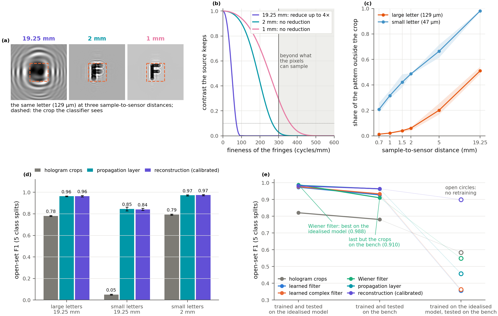

# Checkpoint Z: a distância amostra–sensor da bancada simulada

Material pedido em `PROTOCOLO_Z.md` e nas duas atualizações do mesmo dia. Nada foi regravado nem treinado para este
checkpoint; a parte A (redução) está suspensa. Detalhe, citações com página e comandos: `LEVANTAMENTO_Z.md`,
`PARAMETROS.md`, `CADERNO.md`. Todos os números abaixo vêm de `results_exp_resolucao/`.

## 1. A unidade do z no código e no artigo de 2015

No código, z está em metros e "50k" é 50 000 λ = 19,25 mm:

- gerador original (`OLD-WRONG-projeto-e-testes/data/matlab_generation/run_z.m`, linha 9):
  `CV_FR_focus(im, 1.67e-6, 1.67e-6, -385e-9 * 50000, 385e-9)`;
- kernel (`CV_FR_focus.m`, linha 37): `H = exp(i*k*z).*exp(-i*pi*lambda*z*(u.^2+v.^2))`, com `u` em ciclos/m;
- o nosso `holo_openset/sim/physics.py`, linha 46: `Z0 = 385e-9 * 50000`; linha 129:
  `h = torch.exp(-1j*(pi*wavelength*z)*q)`.

O suplemento do artigo de 2015 confirma a unidade: "We used z×λ to compute the distance between the object and the
detector plane, where image is formed with a wavelength of the light-source λ. For HR holograms, a scale factor k is
applied to up-sampling the distance z and make diffraction equivalent to the LR and HR images." (seção "Diffraction
Calculation"; a Eq. (S3) é o espectro angular). A legenda da Fig. 2 (p. 3) traz "z = [30k, 45k, 60k, 70k]
(k = x1000), according to Equation (S3)".

Então a leitura da unidade estava certa. O que não fecha é o valor: com a fonte declarada, 19,25 mm não permite as
resoluções que o próprio suplemento reporta (Seção 3). Uma hipótese que o artigo não deixa resolver: se os valores da
Fig. 2 foram aplicados a hologramas super-resolvidos tratados com o pixel original, a distância física seria
50 000 λ / 49 ≈ 0,39 mm.

## 2. O levantamento

Quinze trabalhos lidos; cada valor tem página (ou seção, nos manuscritos do PMC, que não têm numeração de página) e
citação literal em `LEVANTAMENTO_Z.md`.

| trabalho | λ / banda (nm) | pinhole ou fibra | fonte–amostra | amostra–sensor | pixel (µm) | super-resolução | resolução reportada |
|---|---|---|---|---|---|---|---|
| Sobieranski 2015 LSA | 385 / não dita | 100 µm | 15 cm até o **sensor** | "as small as possible" | 1,67 | 3×3 e 7×7 quadros | 2,76 / 2,19 / 1,55 µm (largura de linha) |
| Mudanyali 2010 Lab Chip | 591 / 18 | 50 ou 100 µm | ~2–5 cm | < 1–2 mm | 2,2 | não | ~1–2 µm |
| Tseng 2010 Lab Chip | 587 / ~20 | ~100 µm | ~4 cm | < 2 mm | 2,2 | não | ~1,5–2 µm |
| Seo 2009 Lab Chip | monocromador | ~100 µm | ~5 cm | p. ex. 625 µm | 2,2 | não | não dita |
| Bishara 2010 Opt Express | 500–600 / ~5 | fibra 50 µm | ~10 cm | ~0,75 mm | 2,2 | 36 quadros | ~0,6 µm |
| Bishara 2011 Lab Chip | 633 / ~10 | fibra 105 µm | 3–6 cm | ≈ 0,7 mm | 2,2 | 23 quadros | < 1 µm |
| Greenbaum & Ozcan 2012 Opt Express | 550 / ~5 | fibra 100 µm | ~10 cm | ~0,7–1 mm | 2,2 | ~16 por altura | ~1 µm |
| Greenbaum 2012 Nat Methods (revisão) | LED / poucos a 20–30 | 50–100 µm | não dita | ≤ 0,1–2 mm | 1,1 e 6,8 | ~10–100 quadros | < 350 nm (meio passo) |
| Isikman 2012 JSTQE (revisão) | LED / 1–15 | ~0,05–0,1 mm | 4–10 cm | < 4 mm | — | — | ~1,5 µm sem super-resolução |
| Greenbaum 2013 Sci Rep | 480 / ~4; LED 372 | não dito | não dita | ~390 µm; 50–150 µm (óleo) | 6,8 e 1,12 | sim | 225 nm (linhas) |
| Luo 2016 LSA | sintonizável, ~2 | — | — | 100–500 µm | 1,12 | deslocamentos ou λ | 0,98 µm (1 quadro) |
| Kesavan 2014 Sci Rep | LED 525 / não dita | 150 µm | ~5 cm | não dita | 2,2 | não | não resolve 3–5 µm |
| Agbana 2017 Opt Lett | 635 / 0,8 (fibra) | fibra monomodo | — | 2 / 13 / 26 mm | 1,67 | não | 2,5 µm |
| Zhang 2020 IEEE TCI | LED 520 / 20 e 30 | 1,0–1,3 mm (com difusor) | 4–20 cm | 0,465–1,5 mm | 1,67 | não | 1,95 µm (20 nm); 2,46 µm (30 nm) |
| Amann 2019 Sci Rep | LED 430 / 15 | 15 µm | 24,09 mm | 5,91 mm | 1,12 | não | 3,91 µm |

O que a tabela sustenta: nas geometrias on-chip (ampliação ≈ 1), a amostra fica de 0,05 a 2 mm do sensor, e em cerca
de 0,7–1 mm quando o vidro de proteção do sensor fica no lugar (Bishara 2011: "placed directly atop the protective
glass of the image sensor, i.e., approximately z ≈ 0.7 mm"); fontes a 3–10 cm, pinholes ou fibras de 50–150 µm,
banda de 2 a 30 nm. Nada no levantamento pede mudar o pinhole de 100 µm nem os 15 cm da bancada.

Não acessados (sem cópia aberta): Isikman 2011 PNAS, Repetto 2004, McLeod & Ozcan 2016.

## 3. Proposta de configuração

**Orçamento da distância** (amostra na face interna de uma lamínula virada para o sensor, como o prof. Sobieranski
descreveu):

| termo | mínimo / típico / máximo (mm) | fonte |
|---|---|---|
| lamínula nº 1½ | 0,16 / 0,17 / 0,19 | ISO 8255-1:2011, Tab. 1, p. 2 |
| folga de ar (não encosta porque o sensor aquece) | 0,05 / 0,2 / 0,5 | **sem fonte**: comunicação pessoal, valores nossos |
| vidro de proteção do sensor (n = 1,5255) | 0,4 | folha de dados MT9J003/D Rev. 7, p. 54 |
| folga entre o vidro e o chip | 0,125 ± 0,05 | idem |
| **soma geométrica** | 0,69 / **0,90** / 1,27 | |
| **distância efetiva em ar** (soma de t/n) | 0,49 / **0,70** / 1,06 | aproximação paraxial; Bishara 2010 usa o mesmo fator 1/n |

Outras pilhas: amostra sobre uma lâmina de 1 mm, efetiva 1,01 / 1,25 / 1,63 mm; sensor sem o vidro, 0,13 / 0,21 /
0,43 mm.

**Proposta:** z₀ = **0,7 mm de distância efetiva em ar** (cerca de 0,9 mm de distância geométrica; faixa 0,5–1,1 mm).
O simulador propaga em ar, então é a distância efetiva que entra no kernel. Mantêm-se λ = 385 nm, banda de 10 nm,
pinhole de 100 µm a 15 cm do sensor (L = 150 mm − z) e pixel de 1,67 µm.
**Alternativa:** z₀ = 1,0 mm efetivo (número redondo, no alto da faixa do orçamento; é "da ordem de 1 mm" lido como
distância efetiva).
Variação entre montagens: σ ≈ 0,1 mm, quase toda da folga de ar (suposição); hoje o simulador usa 0,5 % de z, que a
0,7 mm seriam 3,5 µm. Dentro da sessão: o aquecimento do sensor torna plausível um drift (comunicação pessoal), que é
o que o conjunto de drift lento simula; não achamos medição de deriva térmica de z na literatura, só do aquecimento
("can easily reach above 40 °C after 'continuous' operation", Greenbaum 2012).

**Coerência com as resoluções reportadas** (envelope da eq. (5) do paper, corte em E < 0,1):

| configuração | z efetivo | borrão da fonte | corte (ciclos/mm) | corte / Nyquist | b_max | meio passo que o envelope deixa | termo dominante |
|---|---|---|---|---|---|---|---|
| proposta | 0,70 mm | 0,47 µm | 414 | 1,38 | 1 | 1,21 µm | largura de banda |
| mínimo do orçamento | 0,49 mm | 0,33 µm | 462 | 1,54 | 1 | 1,08 µm | pixel |
| máximo do orçamento | 1,06 mm | 0,71 µm | 354 | 1,18 | 1 | 1,41 µm | largura de banda |
| alternativa redonda | 1,00 mm | 0,67 µm | 362 | 1,21 | 1 | 1,38 µm | largura de banda |
| `small_near` de hoje | 2,00 mm | 1,35 µm | 266 | 0,89 | 1 | 1,88 µm | largura de banda |
| base de hoje (L até o sensor) | 19,25 mm | 14,7 µm | 67 | 0,22 | 4 | 7,48 µm | imagem do pinhole |
| base de hoje (L até a amostra) | 19,25 mm | 12,8 µm | 72 | 0,24 | 4 | 6,91 µm | imagem do pinhole |

- A 0,7 mm o conteúdo vai além do Nyquist do sensor (299 ciclos/mm): um quadro só fica limitado pelo pixel, e é isso
  que a super-resolução de 49 quadros recupera. Bate com o artigo: 2,76 µm com um quadro, 1,55 µm com 49.
- Pelo mesmo envelope, 2,76 µm pede z ≤ 4,3 mm, 2,19 µm pede z ≤ 2,8 mm e 1,55 µm pede z ≤ 1,3 mm. A 19,25 mm o
  envelope só deixa 6,9 µm: incompatível até com o resultado de um quadro.
- O modelo foi conferido contra dois trabalhos que mediram: Amann 2019, 3,86 µm previsto contra 3,91 medido; Zhang
  2020, 2,22 contra 1,95 e 2,69 contra 2,46 (o limiar de 0,1 é 10–14 % conservador).
- A sua tabela (73, 170, 278, 397 ciclos/mm) é este modelo **sem** o termo da abertura do pixel; com ele (como na
  eq. (5)): 72,4 / 167,6 / 266,4 / 362,2. A conclusão é a mesma: b_max = 1 de 5 mm para baixo.

## 4. Os parâmetros do simulador e as suas fontes

Tabela completa em `PARAMETROS.md` (45 parâmetros, tirados do código) e em
`results_exp_resolucao/simulator_parameters.csv`.

| tipo de fonte | quantos | quais |
|---|---|---|
| artigo (Sobieranski 2015, p. 2) | 6 | λ = 385 nm; pinhole 100 µm; pinhole a 15 cm (do sensor); pixel 1,67 µm; quadro 3840 × 2748; 8 bits |
| folha de dados | 2 | banda de 10 nm (tabela de especificações da Thorlabs para o M385L2, cópia arquivada de 2015-05-04); pó na janela do sensor a 0,5 mm dos pixels (MT9J003, p. 54: 0,525 mm geométrico) |
| só comunicação pessoal | 2 | sem inclinação; drift de z pelo aquecimento do sensor |
| suposição nossa, valor físico | 19 | z₀; variação de z entre sessões (0,5 %); spread de profundidade (50 µm); absorção e fase das letras; poço cheio (6000 e⁻), ruído de leitura (3 e⁻), exposição, PRNU; forma do espectro; pó (densidades, planos, forma); cintura e deslocamento do feixe; 8 blank frames por sessão |
| suposição nossa, escolha de desenho ou numérica | 16 | 7 nós de comprimento de onda, intensidade, Fresnel; 26 classes, fontes, tamanhos das letras, letras por janela, rotação; janela de 640, margens; 100 imagens por sessão, 50 sessões, sementes |

Pontos em que o código, a tabela do paper e o `EQUIPMENT.md` discordam, ou que precisam de atenção:

1. O artigo dá os 15 cm do pinhole até o **sensor**; o código, a tabela do paper e a Seção 4 tratam como até a amostra
   (borrão de 12,8 µm; com a geometria do artigo, 14,7 µm a 19,25 mm; abaixo de 2 mm não faz diferença).
2. O artigo não nomeia o sensor ("Aptina 10 megapixel monochromatic"). MT9J003 é inferência nossa pela área óptica
   (6,413 × 4,589 mm, igual à do artigo); a folha de dados lista filtro Bayer RGB, e o artigo diz monocromático.
3. Poço cheio e ruído de leitura: 6000 e⁻ e 3 e⁻ no código; a folha de dados não os dá em elétrons (derivando do
   SNR máximo e da faixa dinâmica dela sairiam cerca de 2500 e⁻ e 1,4 e⁻; é conta nossa).
4. `EQUIPMENT.md` tem "100 mm" de pinhole (vem da versão PMC do artigo; o PDF diz 100 µm), dá a banda como "não
   confirmada" e cita mal a revisão de Greenbaum 2012.
5. Os planos de pó usam espessuras de vidro como se fossem distâncias em ar; a 0,7 mm o pó da face da lamínula quase
   coincide com o da janela do sensor. Têm de ser revistos junto com z₀.
6. O ganho analógico, que na bancada era ajustado à mão, não é modelado; é omissão a declarar.
7. A "profundidade de campo ≈ 30 µm" que usamos é a limitada pelo pixel; a 19,25 mm o envelope a leva a cerca de
   0,5 mm, e ela só vale de fato perto de 1 mm (afeta a frase "within the depth of field" do paper).

## 5. O efeito de z antes de regravar

**Os três conjuntos que já existem** (média de 5 repetições; a diferença para os crops tem o mesmo sinal em 5 de 5):

| conjunto | F1: crops / camada de propagação / reconstrução em z₀ | rejeição: crops / propagação / reconstrução | fração do padrão fora do crop (letra p5 / mediana / p95) |
|---|---|---|---|
| letras do base, 19,25 mm | 0,781 / 0,963 / 0,964 | 0,104 / 0,924 / 0,923 | 0,59 / 0,51 / 0,39 |
| letras pequenas, 19,25 mm | 0,050 / 0,845 / 0,842 | 0,003 / 0,333 / 0,302 | 1,00 / 0,98 / 0,81 |
| letras pequenas, 2 mm | 0,793 / 0,972 / 0,974 | 0,153 / 0,963 / 0,969 | 0,76 / 0,49 / 0,28 |
| letras do base, 1 mm (só o padrão; não há conjunto) | — | — | 0,05 / 0,02 / 0,01 |

**Quanto do padrão cai fora do crop, em função de z** (mesma definição do painel (c) da figura dos padrões de Fresnel do paper; fonte da bancada):

| letra | 0,7 mm | 1 mm | 2 mm | 5 mm | 19,25 mm |
|---|---|---|---|---|---|
| base, mediana (77 px, 129 µm) | 1 % | 2 % | 6 % | 20 % | 51 % |
| pequena, mediana (28 px, 47 µm) | 21 % | 32 % | 49 % | 66 % | 98 % |

O que isso mostra:

- Com o tamanho de letra fixo, ir de 19,25 para 2 mm corta o vazamento pela metade (98 % → 49 %) e leva os crops de
  0,05 para 0,79 de F1. A camada e a reconstrução continuam 0,18 acima.
- **`small_near` não é prévia do base a 1 mm.** Letras pequenas a 2 mm vazam o mesmo que o base de hoje (49 % e 51 %)
  e têm o mesmo número de Fresnel; por isso a distância entre crops e camada é igual nos dois. O que ele mostra é que,
  com o mesmo vazamento, a vantagem da camada se repete em outro tamanho e outra distância.
- **Letras do tamanho do base a cerca de 1 mm (1–5 % de vazamento) são um regime que nenhum conjunto cobre.** A
  premissa "o crop não contém o seu padrão" vale a 19,25 mm e deixa de valer ali. Se os crops passam a bastar, ou se
  a camada continua ganhando, só uma gravação nova diz.
- Com fonte pontual monocromática o quadro é o mesmo: a causa é a geometria, não a fonte.

**Figura.** O que muda com o setup. (a) A mesma letra de 129 µm gravada a 19,25, 2 e 1 mm do sensor; o tracejado é o
crop que o classificador vê: longe, o padrão passa do crop; perto, cabe nele. (b) Contraste que a fonte da bancada
conserva em função da finura das franjas, nas três distâncias; a faixa cinza é o que o pixel não amostra (além de
299 ciclos/mm); a 19,25 mm a fonte apaga tudo acima de cerca de 70 ciclos/mm e a imagem pode ser reduzida 4×, a 2 e a
1 mm não. (c) Fração do padrão que cai fora do crop em função da distância, para uma letra grande e uma pequena.
(d) F1 open-set dos crops do holograma, da camada de propagação e da reconstrução calibrada nos três conjuntos que
existem. (e) O modelo idealizado contra a bancada: F1 de cada fluxo treinado e testado no idealizado, treinado e
testado na bancada, e (círculos abertos) treinado no idealizado e testado na bancada; o filtro de Wiener é o melhor no
idealizado e o penúltimo na bancada, e só a reconstrução calibrada transfere.

## 6. O que muda se o conjunto base for regravado na distância certa

**Conclusões que precisam ser checadas de novo:**

1. **Crops contra camada (RQ1 e RQ2).** É o ponto central: a cerca de 1 mm o padrão de uma letra do base fica no
   crop. Com objetos pequenos (≈ 50 µm ou menos) ainda vaza de 20 a 30 %.
2. **Autocalibração do α.** A 0,7 mm o α fica fora da faixa de busca de `calibrate_alpha` (que cobre 0,94–75,6 mm), e
   a taxa de aprendizado do α é absoluta. É ajuste de código, mas o resultado "α a 1,5 % da distância verdadeira"
   tem de ser medido de novo.
3. **Foco por objeto e profundidade.** A profundidade de campo cai de cerca de 0,5 mm para cerca de 29 µm; o spread
   de 50 µm passa a ser 5–7 % de z. "O foco por objeto não compra nada" foi medido a 19,25 mm.
4. **Autofocus.** A variação entre montagens (≈ 0,1 mm, 14 % de z) passa da faixa da busca estreita (±13 %); a média
   4 × 4 que a consertou sob ruído corta, a 1 mm, sinal de verdade (o conteúdo vai até 362–414 ciclos/mm); e a busca
   cega (0,2–2,1 z₀) passa a incluir os planos de pó. O estudo de distância inteiro tem de ser revalidado.
5. **Robustez à fonte.** Perto do sensor quem limita é a largura de banda: os conjuntos de pinhole e de distância da
   fonte quase não mudam nada, e os de banda passam a mandar.
6. **Imagem gêmea.** O halo encolhe para cerca de 0,2 mm e cai dentro do crop; a remoção pode passar a importar.
7. **Idealizado contra bancada e objetos pequenos.** O conjunto idealizado tem de ser regravado; `small_near` (2 mm)
   vira o caso distante, e a análise de tamanho inverte.
8. **Parte A.** b_max = 1: não há redução. A 19,25 mm os dois métodos (modelo e espectro às cegas) deram b = 4.
9. **Tempo.** Os tempos por estágio não dependem de z; nada a refazer.

**O simulador precisa mudar antes** (não é só trocar um número): ele calcula o campo no passo do pixel e descarta em
silêncio a faixa de 299 a 362–414 ciclos/mm, que um sensor real registraria como aliasing. Medido contra uma gravação
em grade 2–4× mais fina: 2–4 % do rms do padrão a 1 mm (3–5,5 % a 0,7 mm), contra 0,1–0,4 % a 19,25 mm. Uma gravação
honesta pede sobreamostragem de 2–3× seguida de integração no pixel (código novo). Também: variações de z em unidades
absolutas, L = 150 mm − z, planos de pó em distância efetiva, faixa do α.

**Custo de regravar e retreinar tudo** (M = medido nos logs, E = estimado):

| item | quantidade | custo |
|---|---|---|
| simulação | ≈ 66 500 janelas + quadros inteiros | 1 a 20 h de GPU conforme a disputa pelas GPUs (M) |
| caches de reconstrução | 54 jobs | ≈ 3 h (E) |
| treino | 240 modelos × 1,32 min (M) + 5 YOLO | ≈ 5 h + 1,3–2,5 h (E) |
| avaliações e experimentos | 269 jobs | ≈ 6–7 h (M/E) |
| estudo de distância (varredura na validação) | — | ≈ 2,6 h (M) |
| **total** | 583 jobs | **≈ 20 h de GPU (ociosas) a 35–40 h (disputadas); 1,5–3 dias de relógio**, mais ≈ 1 dia para `expected/` e texto (E) |

Fora isso: o código novo do simulador e a sua validação, e a revisão de quase todo o texto de resultados. Disco:
≈ 165 GB. Reaproveitáveis: o código, as partições de classes, as sessões de tempo e as sementes das cenas (as mesmas
cenas podem ser regravadas, então a comparação entre distâncias é pareada cena a cena). Nenhum número de
reconhecimento é reaproveitável.

## 7. Opções (a decisão é sua)

1. **Não regravar:** declarar 19,25 mm como uma "configuração distante", manter os conjuntos e usar a Seção 5 e a
   figura como a evidência do efeito de z. Custo: só texto. Fraqueza: o conjunto base não é a bancada realista, e a
   premissa central só é demonstrada longe do sensor ou com objetos pequenos.
2. **Um piloto na distância certa antes de decidir (minha recomendação):** implementar a sobreamostragem, gravar as
   mesmas cenas do base a z₀ = 0,7 mm (e, se você quiser, as das letras pequenas), treinar crops, camada de
   propagação e reconstrução em z₀ numa repetição e depois nas cinco, e medir se os crops continuam falhando e se a
   camada continua ganhando. Custo: o código do simulador mais algumas horas de GPU. Responde à pergunta que decide
   todo o resto antes de pagar a regravação completa.
3. **Regravar tudo já** na distância certa: o custo da tabela acima, com o risco de a premissa central mudar no meio.

Decisões que preciso de você para seguir: (a) z₀ = 0,7 mm efetivo ou 1,0 mm; (b) qual das três opções; (c) o
tamanho dos objetos na configuração próxima (letras do base, de 77–234 µm, ou na escala de células, 20–60 µm);
(d) se vale perguntar ao prof. Sobieranski o tamanho da folga, de que lado da lamínula fica a amostra e o modelo
exato do sensor (os três termos sem fonte do orçamento).

## 8. O que não foi possível estabelecer

- O tamanho da folga de ar e a sua variação (só a comunicação pessoal); a deriva térmica de z.
- O modelo do sensor e, portanto, a espessura exata do vidro (0,4 mm no encapsulamento iLCC; outro encapsulamento do
  mesmo sensor tem 0,3 mm).
- A folha de especificações em PDF do LED (bloqueada); o valor de 10 nm vem da tabela de especificações do
  fabricante, numa cópia arquivada de 2015.
- Qual das leituras do "z × λ" do suplemento vale para a Fig. 2 do artigo.
- O tempo de treino do YOLO (não há log) e o tempo de uma gravação sobreamostrada de quadro inteiro.
