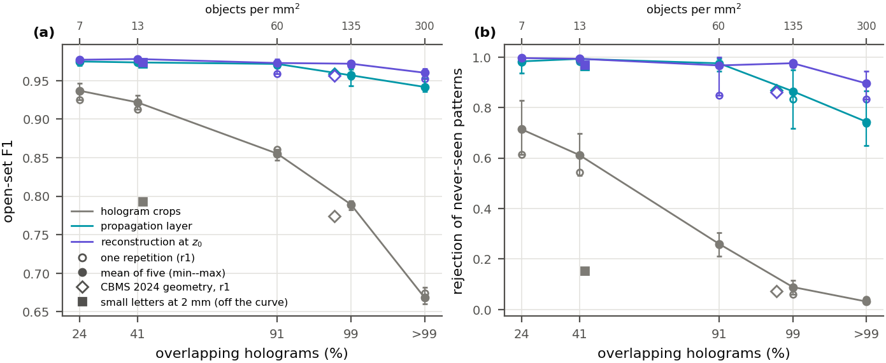

# Curva de densidade, distância e profundidade a 1 mm, e o texto novo do paper

2026-11-15. Instrução e resposta sobre a lei de profundidade em `PROTOCOLO_CURVA.md`; pré-registros (Q0, Q1) em
`CADERNO_CURVA.md`; execução em `CADERNO_CURVA_DENSIDADE.md` e `CADERNO_CURVA_DISTANCIA.md`. Todos os números abaixo
são do teste, lido uma vez, com limiar da validação; conferi cada tabela contra os arquivos por repetição.

## 1. Resultado

**Os crops caem com a densidade; a camada e a reconstrução não caem, pela regra registrada, até 300 objetos por
mm².** Família padrão a 1,0 mm (profundidade uniforme nos 50 µm do canal), mesmas letras nas mesmas posições em
todos os níveis, cinco repetições em cada nível. F1 / rejeição das não vistas, média de cinco:

| objetos por mm² | área coberta | sobreposição | crops | camada | reconstrução |
|---|---|---|---|---|---|
| 7 | 0,5 % | 0,24 | 0,937 / 0,714 | 0,975 / 0,983 | 0,977 / 0,996 |
| 13 | 1,0 % | 0,41 | 0,922 / 0,612 | 0,974 / 0,993 | 0,978 / 0,993 |
| 60 | 4,8 % | 0,91 | 0,855 / 0,260 | 0,972 / 0,975 | 0,973 / 0,967 |
| 135 | 10,5 % | 0,995 | 0,789 / 0,089 | 0,957 / 0,864 | 0,972 / 0,976 |
| 300 | 23,4 % | 1,000 | 0,668 / 0,031 | 0,942 / 0,743 | 0,960 / 0,895 |

- **Crops:** pela regra do Q0 ("caiu" = 0,10 de F1 ou 0,30 de rejeição abaixo do esparso, na mesma repetição, em
  pelo menos 4 de 5), caem em rejeição a partir de 60 por mm² e em F1 a partir de 135 por mm², nas 5 de 5.
- **A camada não "caiu" em nenhum nível.** Você pediu o nível de 300 por mm² para mostrar onde ela cai: pela regra,
  não mostrou. O que se vê é a rejeição dela descer de 0,98 para 0,86 e 0,74 nos dois níveis mais densos (queda
  média de 0,24 no último; por repetição de 0,14 a 0,29, sempre abaixo do 0,30 da regra). O F1 perde 0,03.
- **O empate entre camada e reconstrução vale até 60 por mm².** Nos dois níveis mais densos a reconstrução
  calibrada rejeita mais que a camada nas 5 de 5 repetições (+0,11 e +0,15 de rejeição; +0,015 e +0,018 de F1).
- **O "funciona em conjunto fechado" dos crops também tem limite:** o acerto fechado deles é 0,976 / 0,970 / 0,941 /
  0,894 / 0,770 nos cinco níveis (a camada vai de 0,997 a 0,975).
- **No esparso a margem registrada continua não atingida** (camada − crops: +0,038 de F1 e +0,269 de rejeição; os
  dois limiares em 0 de 5). Ela é atingida nas 5 de 5 a partir de 60 por mm².
- **Distância:** sem recalibrar, 10 % de erro derruba os dois fluxos com propagação; com a recalibração sem rótulo
  a reconstrução volta e a camada fica ≈ 0,045 abaixo dela, em 15 de 15 (seção 5).
- **Profundidade:** dentro do canal de 50 µm, treinar com amostra plana custa 0,02, não 0,2 (seção 4).

## 2. Cinco repetições no denso do piloto (item a)

Conjunto denso do piloto (154 letras por janela, amostra quase plana), cinco repetições:

| fluxo | F1 (média, mín–máx) | rejeição das não vistas (média, mín–máx) |
|---|---|---|
| crops | 0,793 (0,788–0,796) | 0,096 (0,080–0,128) |
| camada | 0,965 (0,957–0,975) | 0,934 (0,872–0,985) |
| reconstrução | 0,970 (0,965–0,975) | 0,967 (0,925–0,994) |

- Camada − crops, pareado: +0,173 de F1 (0,164 a 0,187) e +0,838 de rejeição (0,785 a 0,889). Os limiares do seu
  critério do piloto (≥ 0,10 e ≥ 0,30) são passados nas **5 de 5** repetições, nos dois.
- Reconstrução − camada: +0,005 de F1 e +0,032 de rejeição (sinal misto: 3 de 5 positivas em F1).
- A rejeição dos crops no denso é 0,096 na média de cinco; o 0,08 que estava no texto era só r1.

## 3. Curva de densidade (item b)

Figura do paper. (a) F1 e (b) rejeição das não vistas contra a parcela de hologramas sobrepostos; em cima, objetos
por mm². Pontos cheios: média de cinco repetições com mínimo e máximo; vazados: r1. Losangos: a geometria de CBMS
2024 na sobreposição dela. Quadrados: as letras pequenas a 2 mm, fora da curva.

**Eixo.** O diâmetro efetivo do holograma de uma letra a 1,0 mm é **D = 111,8 µm** (D4σ da energia do padrão;
converge com o raio de medida: 192 e 256 px diferem em 0,17 %), 3,8 vezes o lado médio da letra. A razão de
sobreposição de Seo et al. 2009 é 1 − exp(−π D² σ). Em escala linear os dois níveis mais densos coincidem; por isso
o eixo, fixado no Q1 antes de ler qualquer teste da família, é o expoente π D² σ (o número médio de vizinhas
sobrepostas) em escala logarítmica, com as marcas mostrando a razão de sobreposição. Já no nível esparso 24 % dos
hologramas se sobrepõem: o limite de 10 % de Seo fica abaixo do nosso nível mais esparso.

**Conjuntos.** Cada nível foi conferido contra o esparso: anotações idênticas byte a byte e, em duas imagens
refeitas por nível, a imagem sem o enchimento é idêntica à do esparso. O nível de 300 por mm² obteve 343 letras por janela e 23,4 % de área coberta
(2 letras de enchimento não couberam, em 2 imagens).

**Ordem e regra.** r1 em todos os níveis; a regra "as curvas se separam" (camada − crops ≥ 0,10 de F1 ou ≥ 0,30 de
rejeição em r1, ou algum fluxo caiu) deu sim nos quatro níveis acima do esparso, então todos receberam r2–r5.

Mínimo–máximo das cinco repetições, onde a variação importa:

| objetos por mm² | crops, rejeição | camada, rejeição | reconstrução, rejeição |
|---|---|---|---|
| 7 | 0,614–0,827 | 0,937–1,000 | 0,988–1,000 |
| 13 | 0,531–0,698 | 0,982–1,000 | 0,985–1,000 |
| 60 | 0,211–0,303 | 0,943–0,995 | 0,848–0,998 |
| 135 | 0,059–0,115 | 0,717–0,949 | 0,969–0,983 |
| 300 | 0,022–0,039 | 0,650–0,865 | 0,833–0,944 |

Camada − crops (F1 / rejeição): +0,038 / +0,269; +0,052 / +0,381; +0,116 / +0,715; +0,168 / +0,775; +0,273 /
+0,712. Os dois limiares do critério do piloto são passados em 0 / 0 / 5 / 5 / 5 de 5 repetições.

**O α da camada.** A calibração sem rótulo acha 0,994 a 1,000 mm no esparso; o treino desloca o α em −3,2 % em
média, e o deslocamento diminui com a densidade (−1,6 % no nível mais denso).

**Os conjuntos que já existiam, no mesmo eixo** (só a medida do diâmetro; nenhum teste novo):

| conjunto | distância | D | objetos por mm² | sobreposição (π D² σ) | crops F1 / rejeição |
|---|---|---|---|---|---|
| geometria de CBMS 2024 | 19,25 mm | 447 µm | 7 | 0,988 (4,43) | 0,774 / 0,073 (r1, mesma receita) |
| letras pequenas | 2 mm | 157,5 µm | 7 | 0,42 (0,55) | 0,793 / 0,153 (cinco repetições) |

- A geometria de CBMS 2024 tem a densidade do nosso esparso, mas hologramas quatro vezes mais largos: 99 % deles se
  sobrepõem. Ela fica entre os níveis de 60 e 135 por mm², e os crops dela se comportam como os dali. O eixo de
  sobreposição explica por que ela "parecia densa".
- **As letras pequenas a 2 mm não caem na curva.** Têm a sobreposição do nível de 13 por mm² (crops 0,922 / 0,612)
  e crops de nível denso. A previsão que registrei no Q1 (mesma sobreposição, mesmos crops, qualquer que seja a
  distância) vale para a geometria de CBMS 2024 e falha aqui. Não sei por quê (seção 7).

## 4. Profundidade: a lei padrão (item c)

Você escolheu a lei **uniforme nos 50 µm do canal** (±25 µm em torno da distância da sessão). O simulador ganhou
essa lei sem mudar a sequência de sorteios: as cenas são as mesmas do piloto, letra a letra. A lei antiga de
"50 µm" (normal de desvio 50 µm cortada em ±150 µm, uma faixa seis vezes maior) vira teste de estresse.

F1 médio de camada / reconstrução, treinado → testado (crops não mudam com a profundidade: |Δ| ≤ 0,004):

| treinado \ testado | plano (2,6 µm) | padrão (±25 µm) | larga (estresse) | repetições |
|---|---|---|---|---|
| plano (piloto) | 0,977 / 0,979 | 0,958 / 0,971 | 0,784 / 0,823 | 5 |
| padrão | 0,979 / 0,976 | 0,975 / 0,977 | 0,858 / 0,865 | 5 |
| larga | 0,984 / 0,976 | (não rodado) | 0,977 / 0,975 | 1 |

- **Dentro do canal de 50 µm, treinar com amostra plana custa pouco:** −0,019 de F1 na camada (−0,022 a −0,015, nas
  cinco repetições) e −0,008 na reconstrução.
- **A perda de 0,2 que estava na sua lista é da lei larga**, não da lei que você escolheu: plano → larga perde 0,19
  (camada) e 0,16 (reconstrução), e os modelos da lei padrão também perdem ali 0,12 e 0,11.
- Treinar na lei padrão não custa nada no teste plano (+0,005 na camada).
- O que os números sustentam: o que conta é a profundidade da amostra ficar dentro da faixa vista no treino. No
  texto, o item "a profundidade" da seção da simulação fica com esse tamanho.

## 5. Distância: 0,9 e 1,1 mm, com 0,7 mm como teste de estresse (item d)

Os cinco modelos do nível esparso da família padrão, treinados a 1,0 mm, testados sem retreinar. "Recalibrado" é a
recalibração sem rótulo em 32 hologramas de validação da distância nova; a variante principal (registrada no Q0)
mantém o desvio que o treino deu ao parâmetro da camada ("por razão"). F1 médio de cinco:

| fluxo, condição | 0,7 mm | 0,9 mm | 1,0 mm | 1,1 mm |
|---|---|---|---|---|
| crops, como está | 0,911 | 0,946 | 0,937 | 0,923 |
| camada, como está | 0,015 | 0,426 | 0,975 | 0,289 |
| reconstrução, como está | 0,015 | 0,249 | 0,977 | 0,303 |
| camada, recalibrada (por razão) | 0,919 | 0,932 | — | 0,930 |
| camada, recalibrada (literal) | 0,733 | 0,731 | — | 0,670 |
| reconstrução, recalibrada | 0,964 | 0,978 | — | 0,975 |

- **Sem recalibrar, 10 % de erro na distância derruba os dois fluxos com propagação** (perda de 0,55 a 0,73 de F1 a
  0,9 e 1,1 mm). Eles passam a rejeitar quase tudo (rejeição ≥ 0,993) e acertam só 15 a 29 % das conhecidas. Os
  crops quase não mudam (−0,03 a +0,01).
- **Com a recalibração sem rótulo a reconstrução volta ao nível de 1,0 mm; a camada fica ≈ 0,045 abaixo dela**
  (+0,045 / +0,046 / +0,044 a 0,7 / 0,9 / 1,1 mm; reconstrução acima em 15 de 15 repetições, de 0,034 a 0,058). A
  1,0 mm as duas empatam (+0,002).
- A recalibração acha a distância a −0,8 % / −0,4 % / −0,2 % da verdadeira. Ela escolhe num grid com passo de
  0,27 %, da ordem do próprio erro.
- Com os modelos do piloto (amostra plana, rodada anterior) o quadro é o mesmo, com quedas maiores sem recalibrar
  (camada 0,221 / 0,081) e a reconstrução 0,050 a 0,061 acima da camada recalibrada.

## 6. O texto do paper

Branch `rewrite/inversion` do repositório LaTeX (`53ede2f`, 37 commits a partir do `main`, `b17b8df`). **Sem merge e
sem push.** Compila em 41 páginas, sem referência indefinida. Vão junto o PDF compilado e o diff
`main..rewrite/inversion`.

| seção | o que mudou |
|---|---|
| Abstract | Novo, com os quatro pontos da tese na ordem que você deu. A simulação aparece nele. |
| Introdução | Inversão da tese do CBMS 2024, cinco perguntas, cinco contribuições (a 4 é o simulador e a evidência de que a simulação decide a resposta). |
| Related Work | Reescrito a partir do levantamento: reconhecimento no holograma bruto, o precedente de Seo 2009 / 2010, o argumento de tempo com quem mediu o quê, open-set, domínio da frequência. |
| Fundamentos e bancada | As duas geometrias coerentes (19,25 mm é a do CBMS 2024; a bancada fica a ≈ 1 mm). Hipótese P2 com o mecanismo certo. |
| Método | A camada de propagação descrita como o método proposto (era uma nota pendente). |
| Resultados | Reescritos para as cinco perguntas. O método proposto é a camada de propagação; as camadas de Fourier real e complexa viram ablações. A RQ4 gira em torno do argumento de tempo. |
| Seção nova (8) | "The Simulation Changes the Answer": figura-resumo de cinco painéis; idealizado contra bancada; distância; número de Fresnel; densidade (figura e tabela da curva); profundidade (tabela 3 × 3); recalibração da distância; tabela de todos os parâmetros com valor e fonte (49 linhas). |
| Discussão e conclusão | Discussão só no que contradizia o enquadramento novo; conclusão nova. |

Três frases dos resultados mudaram de sentido ao trocar a camada real pela de propagação, porque os números da
camada de propagação dizem outra coisa:

- **Fonte a 5 cm:** a camada de propagação cai junto com as reconstruções (F1 ≈ 0,50). Quem "degradava mais
  devagar" era a camada real livre.
- **Feixe estreito:** custa mais à camada de propagação (0,88) que à reconstrução em z₀ (0,96).
- **Geometria de CBMS 2024 em conjunto fechado:** os crops acertam 0,881, contra 0,992 dos fluxos com propagação.
  O texto diz "reconhece a maioria das classes vistas", não "funciona".

Notas que continuam no texto: a das letras pequenas a 2 mm (para você decidir), a do levantamento no Related Work
(Scopus e ScienceDirect por rodar) e as das declarações finais (DOI, contribuições, interesses, financiamento).

## 7. O que deu errado ou não fecha

1. **A camada não caiu pela regra.** O nível de 300 por mm² era para mostrar onde ela cai. A queda de rejeição
   ficou em 0,24 (regra: 0,30). Pelo Q0, reporto assim e não gravei nível mais denso sem perguntar. A 23 % de área
   coberta já houve 2 letras de enchimento que não couberam; um nível acima fica perto do limite do
   posicionamento sem sobrepor letras.
2. **As letras pequenas a 2 mm contradizem a previsão do eixo.** Sobreposição 0,42 e crops de nível denso. O
   executor atribuiu a diferença a cenas auxiliares no treino; conferi e está errado: os conjuntos de letras
   pequenas são treinados sem elas (`pipeline.py`, linha 107), como a família de 1 mm. Diferenças conhecidas, sem
   valor de explicação: o conjunto foi gravado na amostragem nativa do sensor (sem a sobreamostragem dos de
   1 mm), as letras têm 15 a 42 px e os números de Fresnel vão de 0,2 a 1,6. O controle C continua válido (mesmas
   letras, só a densidade muda), mas a frase "a sobreposição é a variável" não se sustenta fora da família.
3. **O item "profundidade" da sua lista encolheu.** O 0,2 de perda era da lei larga; na lei padrão que você
   escolheu é 0,02. O texto diz isso.
4. **"A reconstrução calibrada empata com a camada" precisa de duas ressalvas**, e o texto as traz: em amostra
   densa (135 e 300 por mm²) a reconstrução rejeita mais, e depois de recalibrar a distância a camada fica ≈ 0,045
   abaixo.
5. **A rejeição da camada varia entre repetições na família padrão** mais do que no piloto: mínimo de 0,937 no
   esparso (r3) e 0,717 a 0,949 no nível de 135 por mm².
6. **A margem registrada continua não atingida no esparso**, também na família padrão.
7. **Um erro de código do executor, achado antes de existir número:** ao generalizar a medida do diâmetro para as
   outras geometrias, a escala dos raios era sobrescrita por um índice de laço. Corrigido; o script corrigido
   refaz o csv da fase 1 byte a byte.
8. **Levantamento:** as buscas no Scopus e no ScienceDirect continuam não rodadas (sem credencial). O complemento
   aberto (OpenAlex e Semantic Scholar) deu 918 trabalhos, 56 incluídos. Quatro PDFs ficaram bloqueados
   (HoloAtt-UNet 2026, Cotter 2021, Delli Priscoli 2021 e um do JBO 2021).
9. **Horas erradas em duas mensagens minhas de hoje** (escrevi 10:15 e 10:20 quando eram ≈ 10:03). Corrigido no
   plano.

## 8. O que preciso de você

1. **A camada "cair".** Basta dizer que ela não cai pela regra até 300 por mm² e mostrar a descida da rejeição, ou
   você quer um nível mais denso? Recomendo não gravar: a descida já está na figura, e acima de 23 % de área o
   posicionamento das letras começa a falhar.
2. **Letras pequenas a 2 mm.** Manter no eixo com a frase honesta (como está), investigar ou tirar. Recomendo
   investigar com um controle só: regravar esse conjunto com o gravador sobreamostrado e rodar r1 dos três fluxos
   (≈ 1 h). Se a amostragem nativa for a causa, a coluna "small, 2 mm" da tabela de tamanho e distância do paper
   também muda.
3. **Levantamento.** Os .RIS do Scopus e do ScienceDirect (as strings estão em `LEVANTAMENTO_C.md`) e os quatro PDFs
   bloqueados. Sem eles a nota fica no Related Work.
4. **Escolhas minhas que você pode reverter no diff:**
   - a curva (figura e tabela) mora na seção nova, e a RQ1 remete a ela; a alternativa é levá-la para a RQ1;
   - a seção nova vem depois dos resultados; a alternativa é depois da descrição da bancada;
   - escrevi a prosa da camada de propagação no método, que não estava na sua lista, porque o abstract e os
     resultados passaram a depender dela;
   - os fatos da bancada confirmados pelo prof. Sobieranski aparecem como "o que os autores sabem da bancada e o
     artigo não relata", não como comunicação pessoal;
   - o título do paper não mudou.
5. **Figura do quadro inteiro.** Ela ainda mostra a camada real (a legenda diz que é uma ablação). Para mostrar a
   camada de propagação é preciso regenerá-la no pacote principal, o que muda um arquivo de `expected/`. Faço se
   você autorizar.
6. **Push e merge.** Nada foi enviado. Continuam locais: `exp/distancia-autofocus` e `exp/resolucao-fonte` (código),
   os dois commits do `main` do paper e o branch `rewrite/inversion`.

## 9. O que foi feito

- **Código** (`exp/resolucao-fonte`): lei de profundidade uniforme no simulador (opcional; desligada, nada muda),
  com 8 testes novos. `pytest`: 72 passam. `reproduce check`: 13 de 13 idênticos. Nada escrito em `results/` nem
  em `expected/`.
- **Conjuntos novos:** a família padrão (`data/curve_u50_L008`, `_L015`, `_L069`, `_L154`, `_L343`) e as regravações
  a 0,7 / 0,9 / 1,1 mm (`data/curve_u50_robust/`, `data/bench_1mm_robust/`). ≈ 44 GB na família.
- **Treinos e avaliações:** 75 da curva (5 níveis × 3 fluxos × 5 repetições), 12 do denso do piloto (r2–r5), mais as
  avaliações cruzadas de distância e profundidade. Cada teste lido uma vez.
- **Resultados** em `results_exp_resolucao/`: `dense_five_reps.csv`, `hologram_diameter*`, `density_curve.csv`,
  `density_curve_reps.csv`, `curve_alpha.csv`, `distance_tests.csv`, `distance_tests_u50.csv`, `depth_tests.csv`.
- **Pré-registros:** Q0 (08:11, antes de qualquer execução) e Q1 (08:51, antes de gravar a família) em
  `CADERNO_CURVA.md`. Conferi cada tabela dos executores refazendo médias, diferenças pareadas e as regras a partir
  dos arquivos por repetição.
