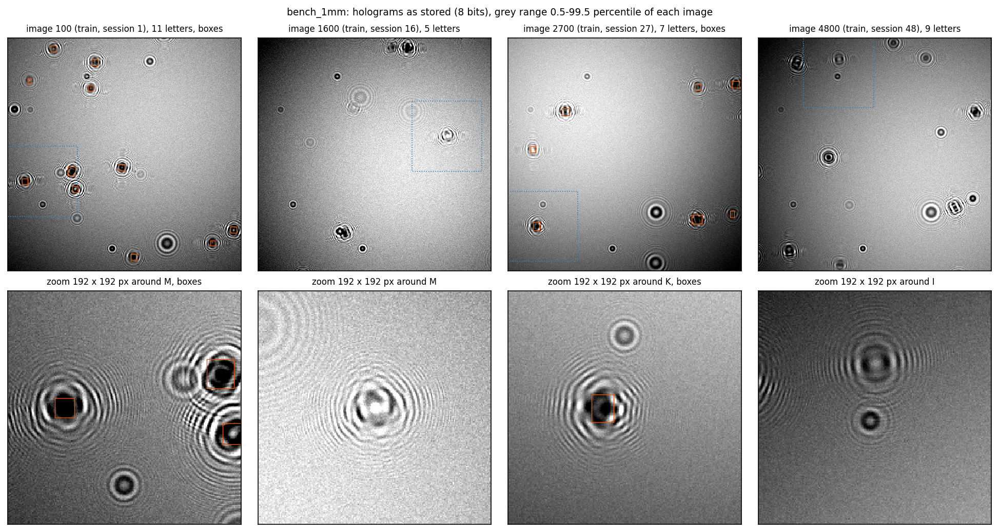
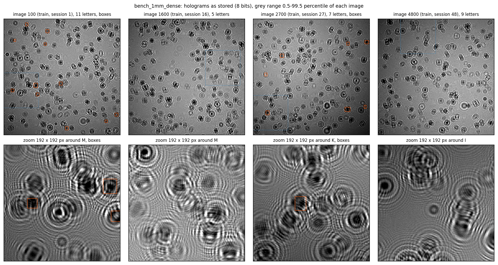

# Piloto a 1,0 mm: cinco repetições, dois controles e treino com profundidade

2026-11-14. Aprovação e respostas em `PROTOCOLO_PILOTO_1MM.md`; pré-registros (P0, P2), execução e conferência (P3)
em `CADERNO_PILOTO_1MM.md`. Este relatório substitui o checkpoint de r1 (`CHECKPOINT_PILOTO.md`).

Atualizado às 21:26: a densidade da amostra passou a ser escolha nossa (seção 8, nova; entrada P4 do caderno). A
pergunta ao prof. Sobieranski saiu das decisões, e a decisão sobre as densidades intermediárias ganhou números.

## 1. Resultado

**O seu critério não foi cumprido: 0 de 5 repetições.** No conjunto do piloto, a camada fica em média 0,039 acima
dos crops em F1 (pedia 0,10) e 0,268 acima em rejeição das não vistas (pedia 0,30). Pela regra que você fixou, a
tese na forma "o crop falha, a camada recupera" não se mantém nesse conjunto.

**Os dois controles dizem por quê: o crop só foi bem porque as letras estavam afastadas.** Com as mesmas letras a
1,0 mm e a densidade relativa do base, os crops voltam a 0,796 de F1 e 0,080 de rejeição, e a camada fica 0,164 e
0,820 acima. O código novo, usado a 19,25 mm, reproduz o base.

| conjunto (r1, teste) | z₀ | letras por janela | área coberta | crops F1 / rej. | camada F1 / rej. | reconstrução F1 / rej. | camada − crops |
|---|---|---|---|---|---|---|---|
| base, código antigo | 19,25 mm | 8 | 10,7 % | 0,774 / 0,073 | 0,959 / 0,869 | 0,956 / 0,862 | +0,185 / +0,796 |
| base, código novo (controle B) | 19,25 mm | 8 | ≈ 10,7 % | 0,763 / 0,061 | 0,960 / 0,867 | 0,957 / 0,840 | +0,197 / +0,806 |
| piloto, esparso | 1,0 mm | 8 | 0,6 % | 0,928 / 0,622 | 0,977 / 0,995 | 0,977 / 1,000 | +0,049 / +0,373 |
| piloto, denso (controle C) | 1,0 mm | 154 | 10,5 % | 0,796 / 0,080 | 0,960 / 0,899 | 0,968 / 0,952 | +0,164 / +0,820 |

Os quatro conjuntos têm o mesmo número de Fresnel (0,3 a 1,0) e o mesmo vazamento do padrão para fora do crop (51 %
na mediana no base e 55 % no piloto). Todos foram treinados com a mesma receita, sem cenas auxiliares. As letras de 1,0 mm são 4,4
vezes menores que as do base; por isso 8 letras por janela cobrem 0,6 % da área a 1,0 mm e 10,7 % a 19,25 mm.

## 2. As cinco repetições no conjunto do piloto (esparso)

| repetição | F1 crops / camada / reconstrução | rejeição crops / camada / reconstrução | camada − crops (F1 / rej.) | cumpre F1 ≥ 0,10 | cumpre rej. ≥ 0,30 |
|---|---|---|---|---|---|
| 1 | 0,928 / 0,977 / 0,977 | 0,622 / 0,995 / 1,000 | +0,049 / +0,373 | não | sim |
| 2 | 0,942 / 0,974 / 0,979 | 0,744 / 1,000 / 1,000 | +0,031 / +0,256 | não | não |
| 3 | 0,934 / 0,977 / 0,981 | 0,700 / 0,993 / 0,991 | +0,043 / +0,293 | não | não |
| 4 | 0,945 / 0,980 / 0,978 | 0,829 / 0,999 / 0,999 | +0,035 / +0,170 | não | não |
| 5 | 0,942 / 0,976 / 0,980 | 0,755 / 1,000 / 1,000 | +0,035 / +0,245 | não | não |
| média | 0,938 / 0,977 / 0,979 | 0,730 / 0,997 / 0,998 | +0,039 / +0,268 | 0 de 5 | 1 de 5 |

- **A camada e a reconstrução empatam:** a reconstrução fica 0,002 acima em F1 e 0,001 em rejeição.
- **O crop acerta as classes conhecidas** (acerto em conjunto fechado de 0,975 a 0,978) **e rejeita mal as não
  vistas:** de 62 a 83 %, contra 99,3 a 100 % da camada.

## 3. Os dois controles (r1, regras de leitura fixadas antes de rodar)

A regra olhava só os crops: o controle fica mais perto do base antigo (0,774 / 0,073) ou do piloto (0,928 / 0,622)?

- **Controle do código (B).** As letras do base a 19,25 mm, com o gravador e a cena novos: crops 0,763 / 0,061. Fica
  a 0,011 e 0,012 do base antigo e a 0,165 e 0,561 do piloto. **A melhora dos crops a 1,0 mm não é efeito do código.**
- **Controle da vizinhança (C).** As mesmas 40 309 letras anotadas do piloto, nas mesmas posições, mais letras não
  anotadas até 154 por janela: crops 0,796 / 0,080. Fica a 0,022 e 0,006 do base antigo e a 0,133 e 0,543 do piloto.
  **A vizinhança explica a melhora.**

Diferença pareada entre o denso e o esparso, letra a letra:

| fluxo | F1 | rejeição das não vistas |
|---|---|---|
| crops | −0,133 | −0,543 |
| camada | −0,017 | −0,096 |
| reconstrução | −0,009 | −0,048 |

Exemplos dos dois conjuntos. Em cada figura, a linha de cima mostra quatro janelas inteiras (640 × 640 pixels) e a
de baixo um recorte ampliado de 192 × 192 pixels de cada uma. As caixas laranja marcam as letras anotadas.

**Piloto, esparso** (8 letras por janela a 1,0 mm):

**Denso, controle C** (as mesmas letras anotadas, mais letras não anotadas até 154 por janela):

## 4. Treino com 50 µm de profundidade (r1)

| treinado com / testado com | crops F1 / rej. | camada F1 / rej. | reconstrução F1 / rej. |
|---|---|---|---|
| 2,6 µm / 2,6 µm | 0,928 / 0,622 | 0,977 / 0,995 | 0,977 / 1,000 |
| 2,6 µm / 50 µm | 0,929 / 0,630 | 0,773 / 0,997 | 0,801 / 1,000 |
| 50 µm / 50 µm | 0,924 / 0,605 | 0,977 / 0,998 | 0,975 / 0,994 |
| 50 µm / 2,6 µm | 0,923 / 0,595 | 0,984 / 0,997 | 0,976 / 1,000 |

**A perda de 0,2 de F1 era do treino com amostra plana.** Treinando com 50 µm de espalhamento, a camada e a
reconstrução voltam a 0,977 e 0,975, e o modelo continua bom em amostra plana.

## 5. Robustez à distância (cinco repetições, modelos de 1,0 mm, sem retreinar)

| condição do teste | crops F1 / rej. | camada F1 / rej. | reconstrução F1 / rej. |
|---|---|---|---|
| 1,0 mm | 0,938 / 0,730 | 0,977 / 0,997 | 0,979 / 0,998 |
| 0,7 mm, como está | 0,911 / 0,743 | 0,015 / 1,000 | 0,015 / 1,000 |
| 0,7 mm, recalibrada sem rótulo (literal) | – | 0,509 / 0,999 | 0,963 / 0,997 |
| 0,7 mm, recalibrada sem rótulo (por razão) | – | 0,914 / 0,996 | 0,964 / 0,996 |

- **Sem recalibrar, a camada e a reconstrução rejeitam tudo a 0,7 mm.** Os crops quase não mudam.
- **A recalibração sem rótulo recupera,** desde que preserve o ajuste do treino. O treino desloca a distância da
  camada em −2,1 a −2,8 %; a variante por razão mantém esse deslocamento e a literal o desfaz.
- A camada recalibrada fica 0,05 abaixo da reconstrução recalibrada em F1 (0,914 contra 0,964).

## 6. Como leio (interpretação minha, posterior aos resultados)

- **O que derruba o crop é o padrão das vizinhas que entra nele.** O esparso e o denso têm o mesmo vazamento do
  padrão da própria letra para fora do crop, e só o denso derruba o crop. Os nossos textos, inclusive o meu
  Checkpoint Z, explicavam a falha pelo vazamento; nesta faixa de número de Fresnel isso não se sustenta sozinho.
- **A distância não muda o quadro quando o número de Fresnel e a densidade relativa são iguais.** O base a 19,25 mm
  e o denso a 1,0 mm dão o mesmo resultado, com coerência e amostragem muito diferentes.
- **A tese passa a depender da densidade da amostra.** Em amostra densa, o crop falha e a camada recupera, a 1,0 mm
  como a 19,25 mm. Em amostra esparsa, o crop reconhece as classes conhecidas e a vantagem da camada fica na
  rejeição das não vistas (0,997 contra 0,730).
- **A 1,0 mm aparecem dois cuidados de método:** a camada precisa ser recalibrada quando a distância muda, e o
  treino precisa ter o espalhamento de profundidade da amostra.

## 7. O que eu não sei

- **Qual densidade é a da bancada.** O prof. Sobieranski não lembra, e não há outra fonte. A densidade fica como
  suposição nossa (seção 8).
- **A partir de que densidade o crop cai.** Só há os dois extremos.
- **Quanto os controles variam entre repetições.** Eles são uma repetição; no base, r1 e a média de cinco diferem em
  até 0,09 na rejeição.
- **Se a reconstrução ganha da camada no denso.** Em r1 ela fica 0,052 acima em rejeição; no base r1 o sinal é o
  contrário. Uma repetição não decide.

## 8. Densidade da amostra: a escolha

**Escolhi não fixar um valor único: a densidade vira um eixo do estudo, de 7 a 135 objetos por mm².** O resultado
dos crops depende dela (0,94 de F1 no esparso, 0,80 no denso), e um valor único decidiria a conclusão por suposição.
Ela continua declarada como suposição nossa.

| nível | objetos por mm² | letras por janela | área coberta | de onde vem | situação |
|---|---|---|---|---|---|
| esparso | 7 | 8 | 0,6 % | o piloto | gravado |
| intermediário 1 | 13 | 15 | 1,0 % | Seo 2009: 10 % dos hologramas se sobrepõem | a gravar |
| intermediário 2 | 60 | 69 | 4,7 % | Seo 2009: limite do método deles sobre o holograma cru | a gravar |
| denso | 135 | 154 | 10,5 % | a densidade relativa da geometria do CBMS 2024 | gravado |

O que a literatura que já estava salva no projeto diz:

- **Seo et al. 2009** (Lab Chip, seção "Discussions") classificam o holograma como gravado, sem reconstrução. Dão a
  fração de hologramas que se sobrepõem em função da concentração: 10 % a 671 células por µL e 37 % a 3000 células
  por µL, num canal de 20 µm. Acima de 3000 os erros de contagem crescem. Em área, pela minha conta, isso dá 13 e 60
  células por mm².
- **Isikman et al. 2012** (revisão, seção III.A), com reconstrução, contam hemácias com erro abaixo de 5 % até
  0,4 milhão de células por µL, com mais de 150 mil células num campo. Pela minha conta, cerca de 6250 por mm².
- **Sobieranski et al. 2015** (conclusões) citam a densidade como limitação intrínseca da holografia em linha.

**Seo 2009 já relata o efeito que os nossos controles mostraram:** o reconhecimento sobre o holograma cru perde
acurácia quando os hologramas se sobrepõem. É precedente, e precisa ser citado no texto.

Ressalva da escolha: as células de Seo têm hologramas de cerca de 50 µm, menores que os das nossas letras. Na mesma
contagem por mm², a nossa sobreposição é maior. A comparação justa é pela razão de sobreposição deles, que pede o
diâmetro efetivo do nosso holograma. Não medi esse diâmetro.

## 9. Decisões que preciso de você

1. **Como a tese muda.** Recomendo a forma condicionada à densidade (terceiro item da seção 6), com o base como "a
   geometria do CBMS 2024" e os conjuntos apresentados por número de Fresnel e por densidade.
2. **Rodar as cinco repetições no conjunto denso?** São mais quatro, cerca de 8 minutos cada, sem regravar.
   Recomendo: permite aplicar o seu critério também ali, com o mesmo rigor.
3. **Gravar os dois níveis intermediários da seção 8?** São 15 e 69 letras por janela, só em r1, para mostrar onde
   o crop cai. As duas gravações somam cerca de 70 minutos, mais 8 de treino cada. Recomendo, junto com a medida do
   diâmetro efetivo do nosso holograma, para reportar também a razão de sobreposição de Seo.
4. **Começar a reescrita (parte B)?** Só começo com o seu pedido.

## 10. Ressalvas

- No controle do código, as letras foram desenhadas numa grade 4 vezes mais fina que o pixel (o piloto usa 16), por
  custo: 46 minutos contra cerca de 6,5 horas. Em relação ao tamanho da letra as duas se equivalem. O efeito isolado
  é de 1,1 a 1,6 % do padrão.
- No conjunto denso só as 8 letras de sempre são anotadas, treinadas e avaliadas; as demais são vizinhança. Foi
  escolha minha, declarada no pré-registro, para a comparação ser pareada.
- A leitura da seção 6 veio depois dos resultados. Só o critério e as regras dos controles foram fixados antes.
- A 0,7 mm, com os vidros do simulador, a lamínula encosta na janela do sensor.

## 11. O que foi feito

- **Conjuntos novos:** `bench_1mm_depth50`, `bench_1mm_dense`, `base_newrec` (5000 imagens cada, 26 GB no total).
- **Treinos:** 12 no piloto (repetições 2 a 5), 3 em cada um dos outros quatro conjuntos.
- **Testes:** `pytest` 64 passam; `reproduce check` 13/13. Nada mudou em `models/`, `results/`, `expected/` nem em
  `data/realistic`.
- **Nada foi enviado:** os commits estão só no ramo local `exp/resolucao-fonte`.

Arquivos, em `results_exp_resolucao/`: `pilot_five_reps.csv`, `pilot_five_reps_robustness.csv`,
`pilot_five_reps_alpha.csv`, `controls.csv`, `controls_reading.json`, `depth_training.csv`, e as avaliações em
`eval/<conjunto>/<fluxo>_r<n>.json`.
